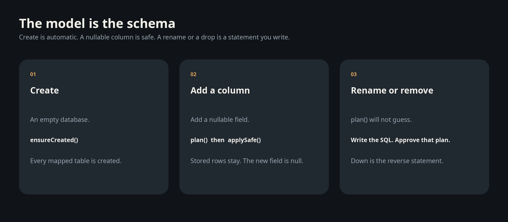
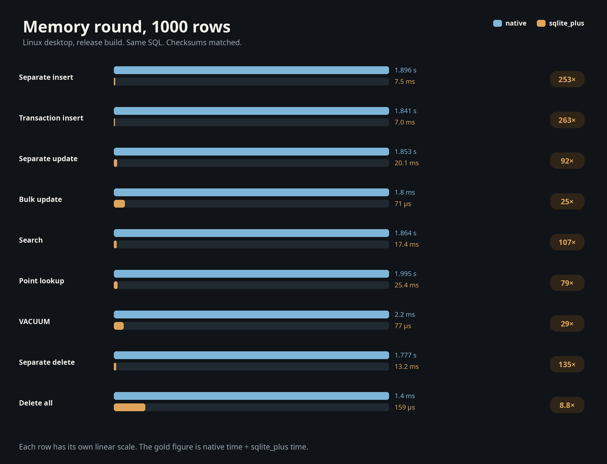
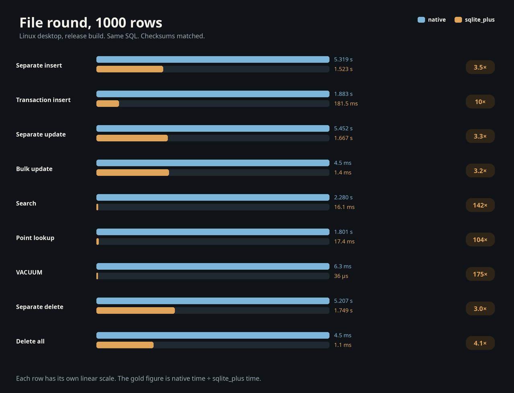
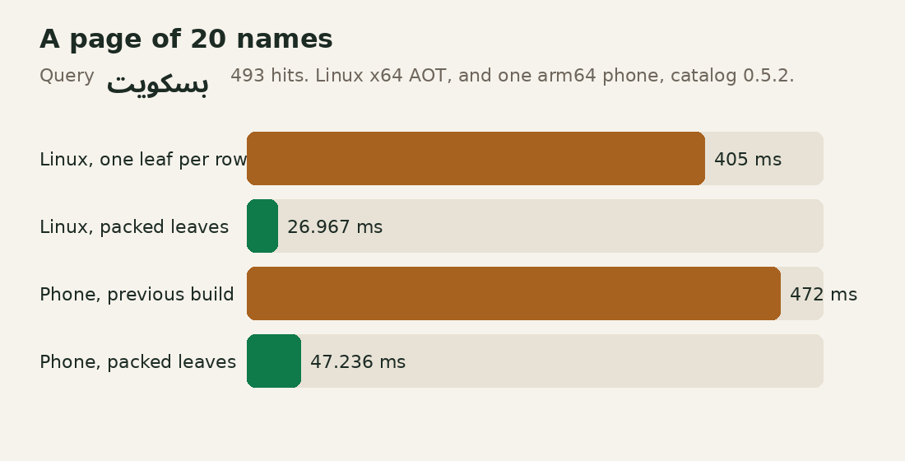
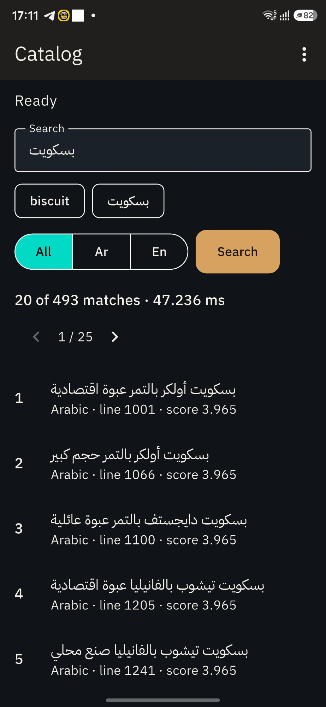

# sqlite_plus

A SQLite engine in Dart, a typed ORM, and a generator for the mapping. SQL, JSON, full-text search, R-tree, change tracking, and reviewed migrations run in the Dart VM. The production runtime has no FFI, no native SQLite, and no WASM.

```yaml
dependencies:
  sqlite_plus: ^0.1.13
  sqlite_plus_orm: ^0.1.12
  sqlite_plus_arabic: ^0.1.6
  sqlite_plus_vec: ^0.1.6
  sqlite_plus_geo: ^0.1.5
  sqlite_plus_search: ^0.1.0-dev.8
  sqlite_plus_changes: ^0.0.1-dev.1
  sqlite_plus_sync: ^0.0.1-dev.1
  sqlite_plus_reactive: ^0.0.1-dev.1
  sqlite_plus_inspector: ^0.0.1-dev.1

dev_dependencies:
  sqlite_plus_generator: ^0.1.12
```

`sqlite_plus_arabic`, `sqlite_plus_vec`, `sqlite_plus_geo`, and `sqlite_plus_search` are optional. Import `sqlite_plus_arabic` for the Arabic stemmer, `sqlite_plus_vec` for a vector column, `sqlite_plus_geo` for geometry, and `sqlite_plus_search` for an offline BM25 index. `sqlite_plus_changes`, `sqlite_plus_sync`, `sqlite_plus_reactive`, and `sqlite_plus_inspector` are optional pre-releases. A package is loaded when the application imports it.

## Query

```dart
import 'package:sqlite_plus/sqlite_plus_io.dart';

final db = await openDatabase(
  'shelf.db',
  version: 1,
  onCreate: (db, version) async {
    await db.execute(
      'CREATE TABLE note (id INTEGER PRIMARY KEY, title TEXT, body TEXT)',
    );
  },
);
await db.insert('note', {
  'title': 'Kept Garden',
  'body': 'a garden kept in the margin',
});
final rows = await db.query(
  'note',
  where: 'title LIKE ?',
  whereArgs: ['%Garden%'],
);
```

The title is `Kept Garden`. A missing `shelf.db` is created. The next launch opens the same file. Integers come back as `BigInt`.

## Track a change

```dart
final books = context.set(BookMapping.instance);
final book = books.add(Book(title: 'Kept Garden'));
await context.saveChanges();

book.title = 'Kept Garden Revised';
await context.saveChanges(); // one row, revision 1
```

## Let the class own the schema

```dart
class Purchase {
  Purchase({this.id, this.customerId, required this.total});
  BigInt? id;
  BigInt? customerId;
  double total;
}

await context.migrations.ensureCreated();

final expensive = await purchases.query
    .selectWhere((row) => (row.total > 20.0) | (row.total.abs() > 20))
    .orderByFields((row) => [row.total.ascending])
    .select();
```

`abs` is the engine, called on the column. A method marked `@DbScalar()` is called the same way: `row.twice() > 20` reads `revision` from the model and runs that body for each row.

`@DbDocument()` stores one object as JSON text. The class supplies `toJson` and `fromJson`. The query reads a nested value, and only the returned rows are decoded.

```dart
final kept = await notes.query
    .filter((row) => row.card.path(r'$.title').equalTo('Kept Garden'))
    .single();
```

`kept.card.pages` is 320. The SQL is `json_extract("card", ?) = ?`. The ORM page shows the class and the revision that follows a later save.

`ensureCreated` builds the table. A later nullable field is `plan()` then `applySafe()`. A rename or a drop is a statement you write and approve. The reverse statement is the down migration.

```sh
dart run sqlite_plus_generator
```

That scans `lib/` for every public `@DbEntity`, writes each `name.orm.g.dart`, and writes `lib/sqlite_plus_migrations.g.dart`. A class that only has an `id` field is not included. One library is still `dart run sqlite_plus_generator --input lib/models.dart`. A later run leaves an unchanged part alone and prints a summary.



## Speed

1,000 rows on Linux, release build. The same SQL, and every checksum matched. Each bar is measured time.



| Operation | native | sqlite_plus | faster |
|---|---:|---:|---:|
| Separate insert | 1.896 s | 7.5 ms | 253× |
| Transaction insert | 1.841 s | 7.0 ms | 263× |
| Separate update | 1.853 s | 20.1 ms | 92× |
| Bulk update | 1.8 ms | 71 µs | 25× |
| Search | 1.864 s | 17.4 ms | 107× |
| Point lookup | 1.995 s | 25.4 ms | 79× |
| VACUUM | 2.2 ms | 77 µs | 29× |
| Separate delete | 1.777 s | 13.2 ms | 135× |
| Delete all | 1.4 ms | 159 µs | 8.8× |

On a file, search was 142×, a point lookup 104×, and `VACUUM` 175×.



## SQL

Joins through `FULL`, subqueries, `UNION` `INTERSECT` `EXCEPT`, CTEs, windows, `ON CONFLICT`, `RETURNING`, views, triggers, `CHECK`, `STRICT`, foreign keys, JSON, FTS5, R-tree, and geopoly. Integers are `BigInt`. `docs/REFERENCE.md` is the statement list.

`SqlCipherDatabase.create('secret')` writes a SQLCipher 4 image. `encryptedImage()` is the file. `database.exportImage()` is the decrypted SQLite image. The default key schedule is PBKDF2-HMAC-SHA512 for 256000 iterations, AES-256-CBC, and HMAC-SHA512, with an 80-byte reserve. Derivation runs when the database is created or opened. A later export reuses those keys. `saveSqlCipher` replaces the whole file. WAL files, SQLCipher 1–3, rekey, a plaintext header, and auto-vacuum with the reserve stay outside this codec.

Compared with pinned SQLite 3.53.1: constant `EXPLAIN` arithmetic, a constant `WHERE`, one table scan, a constant subquery, an integer-primary-key scan, `WITHOUT ROWID`, a virtual generated column, a typed `INSERT`, and a multi-row `VALUES` insert. An integer-primary-key insert and a join of two subqueries still have no bytecode. This is not a VDBE. Contentless FTS4 returns the pinned `MATCH` row and stores no content table. File `journal_mode` `wal`, `persist`, and `truncate` follow the pinned header and journal bytes. This is not a multi-frame WAL. `incremental_vacuum` moves a live end page before truncating. ICU collations are absent. `json_pretty` and correlated `json_each` are in the engine. `json_each(docs.label) RIGHT JOIN docs` returns 0 rows, matching the pinned CLI. Double quotes stay identifiers unless `doubleQuotedStrings` is set. That mode matches the pinned CLI for the cases in `db_browser_b3_dqs_test.dart`. Unquoted `a.title` beside a column named `a.title` returns the `title` column, matching the pinned CLI.

## Keyword search

[`sqlite_plus_search`](packages/sqlite_plus_search) keeps the index in the same database. A page of the product catalog loads 20 names. On one arm64 phone, release build 0.5.2, `بسكويت` read `20 of 493 matches · 47.236 ms`. The catalog holds 10,000 Arabic names and 10,000 English names. That page was 1 of 25, and the score on those titles was 3.965.





The same lists on Linux x64, Dart 3.13.7, AOT, and not a phone: `بسكويت` returned 493 hits and 20 names in 26.967 ms, then 20.819 ms, and 25.663 ms at offset 320. `biscuit` took 19.717 ms, 25.481 ms, and 25.621 ms. The packed image held 347 leaves. Before packing, that Linux process took 405 ms and then 359 ms, and the previous phone build showed 472.000 ms for page 17. Pinned SQLite 3.53.1 opened the packed image: `integrity_check` returned `ok`, and both queries returned 493 rows. There is no embedding model in that catalog.

The package pages are [sqlite_plus](https://pub.dev/packages/sqlite_plus), [sqlite_plus_orm](https://pub.dev/packages/sqlite_plus_orm), [sqlite_plus_generator](https://pub.dev/packages/sqlite_plus_generator), [sqlite_plus_arabic](https://pub.dev/packages/sqlite_plus_arabic), [sqlite_plus_vec](https://pub.dev/packages/sqlite_plus_vec), [sqlite_plus_geo](https://pub.dev/packages/sqlite_plus_geo), and [sqlite_plus_search](https://pub.dev/packages/sqlite_plus_search).

## Packages

| Package | Start here |
|---|---|
| [`sqlite_plus`](packages/sqlite_plus) · [pub.dev](https://pub.dev/packages/sqlite_plus) | SQL, JSON, FTS5, R-tree, `abs`, `exportImage`, SQLCipher 4 |
| [`sqlite_plus_orm`](packages/sqlite_plus_orm) · [pub.dev](https://pub.dev/packages/sqlite_plus_orm) | Saves, revisions, `@DbDocument`, `row.twice()`, `DbModules`, migrations |
| [`sqlite_plus_generator`](packages/sqlite_plus_generator) · [pub.dev](https://pub.dev/packages/sqlite_plus_generator) | Classes in, `DocumentField`, `path`, `@DbScalar`, `search`, `nearest`, and `bounds` out |
| [`sqlite_plus_arabic`](packages/sqlite_plus_arabic) · [pub.dev](https://pub.dev/packages/sqlite_plus_arabic) | FTS5 tokenizer `arabic`. `حديقة` and `الحديقة` share a token |
| [`sqlite_plus_vec`](packages/sqlite_plus_vec) · [pub.dev](https://pub.dev/packages/sqlite_plus_vec) | `vec0` nearest neighbors. A full scan of float32 vectors |
| [`sqlite_plus_geo`](packages/sqlite_plus_geo) · [pub.dev](https://pub.dev/packages/sqlite_plus_geo) | Geometry, spatial SQL, and R-tree queries in Pure Dart |
| [`sqlite_plus_search`](packages/sqlite_plus_search) · [pub.dev](https://pub.dev/packages/sqlite_plus_search) | Packed FTS5 keyword search. One phone page of 20,000 names took 47.236 ms. Not a language model |
| [`sqlite_plus_changes`](packages/sqlite_plus_changes) · [pub.dev](https://pub.dev/packages/sqlite_plus_changes) | A key log of inserts, updates, and deletes, with a durable consumer checkpoint |
| [`sqlite_plus_sync`](packages/sqlite_plus_sync) · [pub.dev](https://pub.dev/packages/sqlite_plus_sync) | An explicit push and pull, with a durable outbox and stored conflicts |
| [`sqlite_plus_reactive`](packages/sqlite_plus_reactive) · [pub.dev](https://pub.dev/packages/sqlite_plus_reactive) | `watch` on the current rows, shared by every listener of the same query |
| [`sqlite_plus_inspector`](packages/sqlite_plus_inspector) · [pub.dev](https://pub.dev/packages/sqlite_plus_inspector) | In-memory timing of the SQL you send through its wrapper |
| [`browser`](browser) | Flutter browser for a database image on phone and desktop |

| You want | Command |
|---|---|
| The engine tour | `(cd packages/sqlite_plus/example && dart run bin/main.dart)` |
| The reading log | `(cd packages/sqlite_plus_orm/example && dart run bin/main.dart)` |
| The generated library | `(cd packages/sqlite_plus_generator/example && dart run bin/main.dart)` |
| Arabic search | `(cd packages/sqlite_plus_arabic/example && dart run bin/main.dart)` |
| Nearest vector | `(cd packages/sqlite_plus_vec/example && dart run bin/main.dart)` |
| Nearby facility | `(cd packages/sqlite_plus_geo/example && dart run bin/main.dart)` |
| A clinic shelf | `(cd packages/sqlite_plus_search/example && dart run bin/main.dart)` |
| The database browser | `(cd browser && flutter run)` |

## Arabic search and a nearest vector

The closed names are `String` constants on [`sqlite_plus_orm`](packages/sqlite_plus_orm). `DbModules.fts5` and `'fts5'` are the same value, so a name that is not in the list can still be written by hand. The ORM creates `fts5`, `rtree`, and `vec0`. A tokenizer such as `'arabic'` is kept as text and checked when the table is created.

[`sqlite_plus_arabic`](packages/sqlite_plus_arabic) registers the stemmer. [`sqlite_plus`](packages/sqlite_plus) stores the FTS5 index. The generator writes `search`. The generated part does not import the Arabic package.

```dart
import 'package:sqlite_plus_arabic/sqlite_plus_arabic.dart';
import 'package:sqlite_plus_orm/sqlite_plus_orm.dart';

@DbEntity(module: DbModules.fts5, tokenizer: ArabicTokenizers.arabic)
class Note {
  Note({this.rowid, required this.body});
  @DbKey(generated: true)
  final BigInt? rowid;
  final String body;
}

SqlitePlusArabic.register(connection.database);
await context.migrations.ensureCreated();
notes.add(Note(body: 'في الحديقة'));
notes.add(Note(body: 'سيارة'));
await context.saveChanges(); // 2
final garden = await notes.query.search('الحديقة').single();
```

`garden.body` is `في الحديقة`. `حديقة` and `الحديقة` share a token. `search('سيارة')` returns no row. The created SQL contains `tokenize = 'arabic'`. The Arabic README lists the folds, the prefixes, and why `الله` stays `الله`.

[`sqlite_plus_vec`](packages/sqlite_plus_vec) registers `vec0`. The ORM writes `float[N]` and `nearest`. The scan reads every stored float32 vector.

```dart
import 'package:sqlite_plus_vec/sqlite_plus_vec.dart';

@DbEntity(module: DbModules.vec0)
class Point {
  Point({this.rowid, required this.embedding});
  @DbKey(generated: true)
  final BigInt? rowid;
  @DbVector(2, metric: DbVectorMetrics.l2)
  final List<double> embedding;
}

SqlitePlusVec.register(connection.database);
await context.migrations.ensureCreated();
points.add(Point(embedding: const [1, 0]));
points.add(Point(embedding: const [0, 1]));
await context.saveChanges(); // 2
final nearest = await points.query.nearest(const [0.9, 0.1], k: 1).single();
```

`nearest.embedding` is `[1.0, 0.0]`. `[0.9, 0.1]` is closer to that row than to `[0, 1]`. The created SQL contains `float[2] distance_metric=l2`. `l2` is Euclidean distance. `DbVectorMetrics.cosine` runs from 0 to 2. The vec README shows `k = 2`, the shadow table, and the same query in SQL.

[`sqlite_plus_geo`](packages/sqlite_plus_geo) stores EWKB and registers spatial SQL on the same connection. `GeoSession.nearest` orders by the chosen distance. `GeodesicModel.sphere` is metres. `GeodesicModel.planar` is the stored axes. `EXPLAIN QUERY PLAN` does not show the spatial index. `SpatialPlan.describe()` does. The package README lists the registered functions and the limits.

Register each package before `ensureCreated`, and register it again after the image is reopened. [`sqlite_plus_generator`](packages/sqlite_plus_generator) emits `tokenizer: "arabic"`, `Codecs.vector(2)`, `search`, and `nearest` from the classes above. It does not emit a geometry field. The geo codec is `sqlite_plus_geo/orm.dart`.

The two examples print:

```text
في الحديقة | missed true | stable true
1.0 | stable true
```

The first line is the Arabic note, a miss on `سيارة`, and an empty second migration plan. The second line is the first coordinate of the nearer vector, and an empty second plan.

## Develop

Packages require Dart >=3.6.0. From the repository root:

```sh
dart pub get --enforce-lockfile
dart format .
for package in sqlite_plus sqlite_plus_orm sqlite_plus_generator sqlite_plus_arabic sqlite_plus_vec sqlite_plus_geo sqlite_plus_search; do
  (cd packages/$package && dart analyze --fatal-infos && dart test) || exit
done
```

## A change log, a sync, a watch, a trace

[`sqlite_plus_changes`](packages/sqlite_plus_changes) writes the changed keys into `products.db` and lets one consumer acknowledge them. [`sqlite_plus_sync`](packages/sqlite_plus_sync) pushes that log when the application calls `runOnce`. [`sqlite_plus_reactive`](packages/sqlite_plus_reactive) is what `books.query.watch()` uses. [`sqlite_plus_inspector`](packages/sqlite_plus_inspector) times the SQL that goes through its wrapper. Each package README opens on its own file. `page` on `openDatabase` is part of the engine, and the ORM page uses the same cursor.
