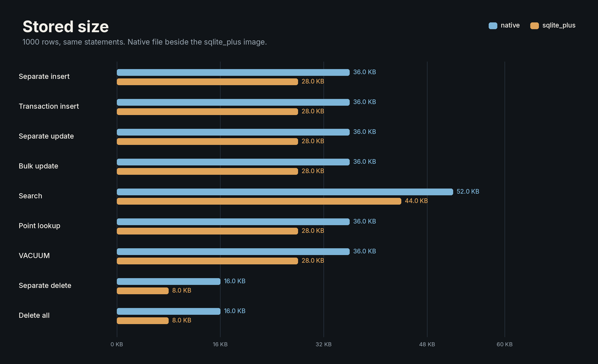

# sqlite_plus

A Pure Dart SQLite engine, a typed ORM, and a mapping generator. SQL, JSON, FTS5, R-tree, change tracking, and generated filters run in the Dart VM. The production runtime has no FFI, native SQLite, or WASM.

Version `0.0.3`.

## Packages

| Package | Import | What you get |
|---|---|---|
| [`sqlite_plus`](packages/sqlite_plus) | `package:sqlite_plus/sqlite_plus.dart` | In-memory SQL, JSON, FTS5, R-tree, geopoly, and `exportImage` |
| File adapter | `package:sqlite_plus/sqlite_plus_io.dart` | `DatabaseOwner` for a `dart:io` file |
| [`sqlite_plus_orm`](packages/sqlite_plus_orm) | `package:sqlite_plus_orm/sqlite_plus_orm.dart` | Tracked objects, bound predicates, relationships, reviewed migrations |
| [`sqlite_plus_generator`](packages/sqlite_plus_generator) | dev dependency `sqlite_plus_generator` | `filter`, JSON `path`, FTS `search`, R-tree `bounds` |

The file adapter imports `dart:io`. The other two libraries do not. The generator runs on the development machine. The application it writes depends on the ORM.

## Install

```yaml
dependencies:
  sqlite_plus: ^0.0.3
  sqlite_plus_orm: ^0.0.3

dev_dependencies:
  sqlite_plus_generator: ^0.0.3
```

## Where to start

| You want to | Open |
|---|---|
| Run SQL yourself | [`packages/sqlite_plus`](packages/sqlite_plus) |
| Keep Dart objects and let the runtime write SQL | [`packages/sqlite_plus_orm`](packages/sqlite_plus_orm) |
| Declare classes and generate the mapping | [`packages/sqlite_plus_generator`](packages/sqlite_plus_generator) |

## Examples

Each package has an example project under `example/`. From a checkout, after `dart pub get` at the repository root:

| Example | Command | Printed line |
|---|---|---|
| Engine tour | `(cd packages/sqlite_plus/example && dart run bin/main.dart)` | `Kept Garden (320 pages) \| a garden [kept] in the margin \| Arabic Shelf x1 \| place 1 \| cards 2 \| version 7 \| reopen Kept Garden v7 \| 40960 bytes` |
| Reading log | `(cd packages/sqlite_plus_orm/example && dart run bin/main.dart)` | `Kept Garden Revised on north, revision 1; Other Atlas stays at revision 0; 1 match; idle save 0` |
| Generated library | `(cd packages/sqlite_plus_generator/example && dart run bin/main.dart)` | `Ada bought [22.5, 30.0]; {"title":"kept"}; alpha kept; place 1 of 2` |

`examples/compare` is Bench, an English Flutter screen that runs the same SQL on Android SQLite through `sqflite` and on sqlite_plus. Each operation runs twice: both engines in memory, then both engines on a database file. The count is from 1 to 10000. The operations are separate inserts, one transaction of inserts, separate updates, one bulk update, indexed name search, primary-key reads, `VACUUM`, separate deletes, and one delete of every row. Preparation and, for sqlite_plus, `exportImage` are logged beside the measured interval. Copy log puts the whole log on the clipboard. The screen keeps a process RSS and CPU readout while a run is in progress. Release APKs are local build output, one file per ABI, and they are not stored in this repository.

The figure and the first table are one 1000-row file round from Bench versionCode 2009, Asia/Hebron 14:00 on 2026-10-29. Both engines used a database file. Every checksum matched. Each bar is linear for that row. The phone model was not in the log. sqlite_plus was faster on every operation in this sample, in memory and on a file. The size figure is the same file round, taken before close, so the sqlite_plus file still includes the redo. Separate delete was 603.6 KB against the native 16.0 KB.




| Operation | native | sqlite_plus | faster |
|---|---:|---:|---:|
| Separate insert | 326.8 ms | 162.2 ms | 2.0× |
| Transaction insert | 81.0 ms | 72.6 ms | 1.1× |
| Separate update | 477.6 ms | 381.2 ms | 1.3× |
| Bulk update | 915 µs | 246 µs | 3.7× |
| Search | 129.4 ms | 11.7 ms | 11× |
| Point lookup | 105.9 ms | 7.6 ms | 14× |
| VACUUM | 923 µs | 13 µs | 71× |
| Separate delete | 413.8 ms | 345.5 ms | 1.2× |
| Delete all | 773 µs | 259 µs | 3.0× |

Memory round from the same sample:

| Operation | native | sqlite_plus | faster |
|---|---:|---:|---:|
| Separate insert | 99.0 ms | 5.0 ms | 20× |
| Transaction insert | 82.1 ms | 2.1 ms | 39× |
| Separate update | 92.4 ms | 10.7 ms | 8.6× |
| Bulk update | 336 µs | 106 µs | 3.2× |
| Search | 108.0 ms | 6.5 ms | 17× |
| Point lookup | 97.7 ms | 9.6 ms | 10× |
| VACUUM | 781 µs | 10 µs | 78× |
| Separate delete | 93.7 ms | 7.3 ms | 13× |
| Delete all | 195 µs | 97 µs | 2.0× |

`examples/notes` is Margin, an English Flutter notes application on the ORM. The screen is a left-to-right desk of paper cards. From that directory, `flutter test` covers a save that reopens from the database image. The Android release packages are local build output, one file per ABI, and they are not stored in this repository. The tools screen inserts random notes through the ORM in a separate isolate, with one `saveChanges` transaction or one save per note, and reports wall time, process CPU time, and RSS. The single `saveChanges` writes the added notes with multi-row `INSERT` statements. Separate saves keep the loaded rows until the image is exported once. Delete-all sends one `DELETE`. The same screen opens a live page of process RSS and CPU, including while an insert or delete is running. It can show the database file and run `VACUUM`.

Check the generated part before running the library:

```sh
(cd packages/sqlite_plus_generator/example && dart run sqlite_plus_generator --input lib/models.dart --check)
```

## Engine, in one image

`packages/sqlite_plus/example/lib/library_tour.dart` builds one in-memory database. The same image is exported and opened again.

| Step | Call | Result |
|---|---|---|
| Two JSON cards | `json_object` with bound arguments | `Kept Garden`, `320` pages |
| Rolled-back insert | `BEGIN`, insert, `ROLLBACK` | `COUNT(*)` is `2` |
| JSON path | `json_extract` with a bound path | title and page count from the card |
| Full text | `fts5`, `highlight`, `bm25`, `MATCH 'kept'` | `a garden [kept] in the margin`, finite rank |
| Unicode token | `MATCH` on an Arabic token | `Arabic Shelf`, count `1` |
| Spatial | `rtree` unit box | shelf id `1` |
| Reopen | `PRAGMA user_version=7`, `exportImage`, `fromImage` | title and version `7`, `40960` bytes |

```dart
final db = await MutableSqliteDatabase.create();
db.functions.registerScalar('twice', 1,
    (args) => args.single == null ? null : (args.single as BigInt) * BigInt.two);
final doubled = await db.query('SELECT twice(?)', [21]);
```

`doubled` is `42`. The callback stays on that connection. The full tour is in the [engine README](packages/sqlite_plus).

## ORM, with names instead of SQL

`packages/sqlite_plus_orm/example/lib/reading_log.dart` maps a `Book`, saves two rows, renames one, and reads it by title and by a JSON shelf.

| Step | Call | Result |
|---|---|---|
| Insert | `books.add` twice, `saveChanges` | `2` |
| Rename | assign `title`, `saveChanges` | `1`, revision `1` |
| Idle save | `saveChanges` | `0` |
| Filter | `title.eq(...) & MappedField.at(r'$.shelf')` | `Kept Garden Revised` on `north` |
| Other shelf | path `south` | `Other Atlas` at revision `0` |

## Generated Dart

`packages/sqlite_plus_generator/example/lib/models.dart` declares five classes. The application saves ten rows and reads four of them.

| Class | Annotation | Generated call | Result |
|---|---|---|---|
| `Customer` | `@DbVersion()` | `reference(...).load()` | `Ada` |
| `Purchase` | `customerId` | `filter((row) => row.total > 20)` | `22.5`, then `30.0` |
| `Note` | `@DbJson()` | `path(r'$.title').equalTo('kept')` | `{"title":"kept"}` |
| `Article` | `@DbEntity(module: 'fts5')` | `search('kept')` | `alpha kept` |
| `Place` | `@DbEntity(module: 'rtree')` | `bounds.intersects(unit rect)` | place `1` of `2` |

```dart
final rows = await purchases.query
    .filter((row) => row.total > 20.0)
    .orderByFields((row) => [row.total.ascending])
    .toList();
```

## SQL surface

| Area | Available |
|---|---|
| Queries | `INNER` `LEFT` `RIGHT` `FULL` `CROSS` `NATURAL` joins, subqueries, `EXISTS`, `IN`, `UNION` `INTERSECT` `EXCEPT`, CTEs, `GROUP BY`, `HAVING` |
| Windows | `ROW_NUMBER` `RANK` `DENSE_RANK` `PERCENT_RANK` `CUME_DIST` `NTILE` `LAG` `LEAD` `FIRST_VALUE` `LAST_VALUE` `NTH_VALUE` |
| Writes | `INSERT` `UPDATE` `DELETE`, multi-row `VALUES`, `OR IGNORE` `REPLACE` `FAIL` `ROLLBACK`, `ON CONFLICT`, `RETURNING`, `BEGIN` `COMMIT` `ROLLBACK`, savepoints |
| Schema | Tables, indexes, views, triggers, `ALTER TABLE`, `CHECK`, `STRICT`, foreign keys, expression and partial indexes, generated columns |
| JSON | `json` `jsonb` `json_array` `json_extract` `json_object` `json_set` `json_patch` and the rest of that family, plus `->` and `->>` |
| Search | FTS5 `MATCH` `highlight` `snippet` `bm25`, R-tree, geopoly, `generate_series` |
| Values | `BigInt` integers, bound `?` `:name` `@name` `$name`, `DATE` `TIME` `DATETIME` `STRFTIME`, math, `median`, `percentile` |
| Your code | `registerScalar`, `registerAggregate`, `createCollation` |

`docs/REFERENCE.md` is the statement reference. `docs/ENGINE_SUPPORT.md` is the baseline behind this table.

## Android

A debug APK ran on an Android 15 emulator, API 35, `x86_64`, with Flutter 3.47.8 and Dart 3.13.7. The log is `packages/sqlite_plus/tool/android_probe_api35_x86_64.log`.

| Check | Result |
|---|---|
| Memory SQL | JSON card `Kept Garden` / `320`, FTS5 highlight, finite `bm25`, R-tree id `1`, `user_version` `7` after reopen, `40960` bytes |
| ORM | insert `2`, update `1`, idle `0`, title `Kept Garden Revised`, revision `1` |
| File | `DatabaseOwner` in the app cache, version `7`, title `Kept Garden` |

An iOS simulator run is planned.

## Planned

| Area | Next |
|---|---|
| JSON | `json_pretty`, correlated `json_each` |
| Planner | EXPLAIN bytecode, STAT4, `auto_vacuum` |
| Durability | A durable commit across two databases, more journal modes, power-loss durability, a durable browser store |
| FTS | Multi-page leaves, porter, trigram, detail, tokendata, locale, FTS3/FTS4 writes |
| Collations | ICU and locale collations |
| Platforms | iOS |
| Scale | Benchmarks at 100000 and 1000000 rows |

The current measurement is the 10000-row Linux AOT file `benchmark_results/scenarios_10k_linux_x64.json`. `COMPATIBILITY_MATRIX.md` is the test record.

## Develop

The workspace lockfile is at the repository root. Packages require Dart >=3.6.0. CI uses Dart 3.13.7.

```sh
dart pub get --enforce-lockfile
dart format .
python3 tool/generate_fixtures.py --verify
for package in sqlite_plus sqlite_plus_orm sqlite_plus_generator; do
  (cd packages/$package && dart analyze --fatal-infos && dart test) || exit
  (cd packages/$package/example && dart analyze --fatal-infos && dart test && dart run bin/main.dart) || exit
done
```

The Linux GitHub job runs every `tool/generate_*.py --verify` script. A checksum mismatch fails that job. Those scripts compare fixture hashes. The macOS and Windows jobs run format, fatal-info analysis, package tests, and the example project check. `CHANGELOG.md` records this version.
