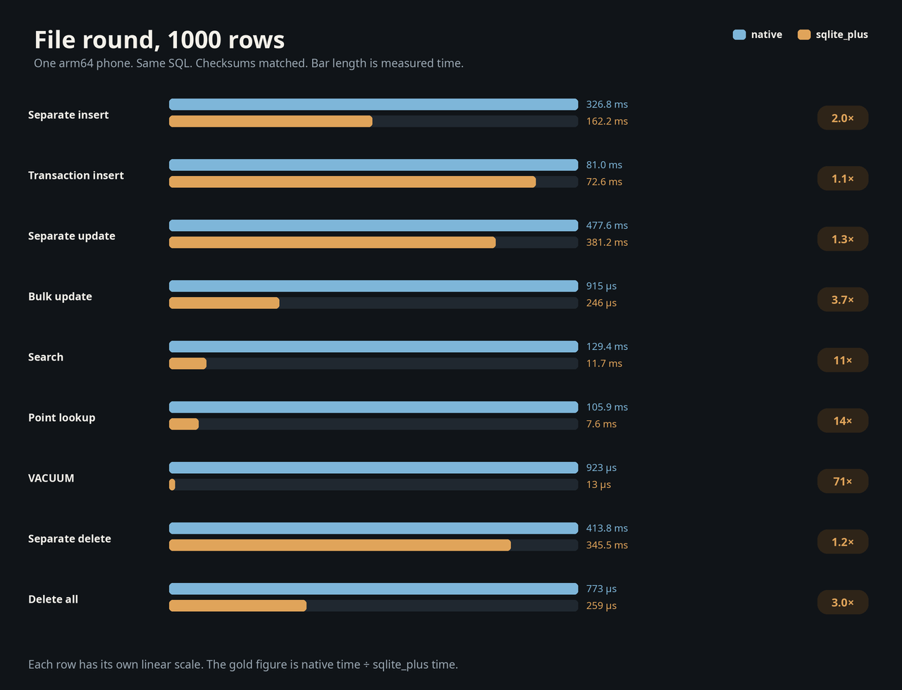

# Bench

Bench is a Flutter application that runs the same SQL on Android SQLite and on sqlite_plus, then keeps a log of both. Every operation runs twice. The memory round opens both engines in memory. The file round opens both engines on a database file. The screen is English, left to right, and set in IBM Plex Sans Arabic under the SIL Open Font License. See `assets/fonts/OFL.txt`. Copy log places the whole log on the clipboard, oldest entry first, with a comparison line for each finished pair.

The application is `publish_to: none`. It is not a workspace member, because the workspace is resolved with the Dart SDK and this project needs the Flutter SDK. `dependency_overrides` points `sqlite_plus` at the package in this repository. Android SQLite is opened with `sqflite` inside this application only.

## What a run measures

The table is `bench(id INTEGER PRIMARY KEY, name TEXT, body TEXT, n INTEGER)`. Both engines execute the same statements. The count is a number from 1 to 10000.

| Operation | Measured statements |
|---|---|
| Separate insert | One autocommit `INSERT` per row |
| Transaction insert | The same `INSERT` statements. sqlite_plus uses `BEGIN` and `COMMIT`. Android SQLite uses one `sqflite` transaction |
| Separate update | `UPDATE bench SET n = n + 1 WHERE id = ?` once per row |
| Bulk update | `UPDATE bench SET n = n + 1` |
| Search | `SELECT id FROM bench WHERE name = ?` once per row, after `CREATE INDEX bench_name ON bench(name)` |
| Point lookup | `SELECT body FROM bench WHERE id = ?` once per row |
| VACUUM | `VACUUM` |
| Separate delete | `DELETE FROM bench WHERE id = ?` once per row |
| Delete all | `DELETE FROM bench` |

Preparation sits outside the measured interval. For search, preparation inserts the rows and creates `bench_name`. The log records that preparation on its own line. A memory sqlite_plus run also records the time and byte size of `exportImage`. A file run records the database file instead, and its export time is 0. The native file size includes a `-wal`, `-shm`, or `-journal` sidecar when one is present. A memory native size is `page_count * page_size`. Each finished pair compares row count, `SUM(n)`, and the number of hits inside one storage round. The screen shows `sqlite_plus / native` for the measured intervals.

Memory sqlite_plus work runs in a separate isolate. File sqlite_plus work opens `bench-sqlite-plus.db` with a redo log in that same isolate. An autocommit change syncs that redo once. The database pages stay unwritten until the redo passes 16 MiB or the database closes. A bulk integer update journals the addend instead of rewriting the leaves. A transaction commits on `COMMIT`, which is inside the measured interval, by the same redo sync. The measured file size is taken before close, so it includes the redo. The bench writes an empty image and an empty journal, flushes both, then passes `directoryEntryIsDurable: true`. That flag is the caller attestation. It is not a power-loss result. This path does not open a loopback socket. Native memory is sqflite `:memory:` with `singleInstance: false`. Native file stays `bench-native.db` under the application documents directory, opened by sqflite with its default journal mode. The memory and CPU figures on the screen are for the whole process and keep updating while a run is in progress.

## 1000 rows

The table below is the earlier sample: native on a file, sqlite_plus in memory, arm64 versionCode 2003. Every pair matched on row count, `SUM(n)`, and hits. The ratio is the measured sqlite_plus interval divided by the measured native interval. The app now records a memory pair and a file pair separately. The charts for the later file round are in the versionCode 2009 section.

| Operation | native | sqlite_plus | ratio | rows | sum | hits |
|---|---:|---:|---:|---:|---:|---:|
| Separate insert | 514.9 ms | 6.5 ms | 0.01 | 1000 | 500500 | 1000 |
| Transaction insert | 104.6 ms | 3.5 ms | 0.03 | 1000 | 500500 | 1000 |
| Separate update | 508.2 ms | 247.5 ms | 0.49 | 1000 | 501500 | 1000 |
| Bulk update | 1.3 ms | 92 µs | 0.07 | 1000 | 501500 | 1000 |
| Search | 126.3 ms | 7.6 ms | 0.06 | 1000 | 500500 | 1000 |
| Point lookup | 116.2 ms | 9.6 ms | 0.08 | 1000 | 500500 | 1000 |
| VACUUM | 1.2 ms | 9 µs | 0.01 | 1000 | 500500 | 1 |
| Separate delete | 352.7 ms | 168.0 ms | 0.48 | 0 | 0 | 1000 |
| Delete all | 732 µs | 105 µs | 0.14 | 0 | 0 | 1000 |

Preparation, export, file size, process CPU, and process RSS from the same log:

| Operation | Engine | CPU | Memory | Prepare | Export | Size |
|---|---|---:|---|---:|---:|---:|
| Separate insert | native | 430.0 ms | 171.38 MB → 177.42 MB | 510 µs | 0 µs | 36.0 KB |
| Separate insert | sqlite_plus | 20.0 ms | 177.79 MB → 178.40 MB | 2.8 ms | 3 µs | 28.0 KB |
| Transaction insert | native | 130.0 ms | 182.86 MB → 185.34 MB | 483 µs | 0 µs | 36.0 KB |
| Transaction insert | sqlite_plus | 0 µs | 185.33 MB → 185.33 MB | 986 µs | 3 µs | 28.0 KB |
| Separate update | native | 450.0 ms | 188.16 MB → 189.14 MB | 166.1 ms | 0 µs | 36.0 KB |
| Separate update | sqlite_plus | 370.0 ms | 188.55 MB → 189.17 MB | 4.2 ms | 4 µs | 28.0 KB |
| Bulk update | native | 0 µs | 191.61 MB → 191.61 MB | 134.5 ms | 0 µs | 36.0 KB |
| Bulk update | sqlite_plus | 0 µs | 191.41 MB → 191.54 MB | 4.0 ms | 3 µs | 28.0 KB |
| Search | native | 160.0 ms | 194.11 MB → 197.14 MB | 109.2 ms | 0 µs | 52.0 KB |
| Search | sqlite_plus | 10.0 ms | 197.37 MB → 197.37 MB | 107.6 ms | 4 µs | 44.0 KB |
| Point lookup | native | 150.0 ms | 199.83 MB → 202.65 MB | 184.7 ms | 0 µs | 36.0 KB |
| Point lookup | sqlite_plus | 10.0 ms | 202.64 MB → 202.64 MB | 4.4 ms | 3 µs | 28.0 KB |
| VACUUM | native | 0 µs | 182.77 MB → 182.82 MB | 114.7 ms | 0 µs | 36.0 KB |
| VACUUM | sqlite_plus | 0 µs | 182.80 MB → 182.80 MB | 4.8 ms | 3 µs | 28.0 KB |
| Separate delete | native | 230.0 ms | 185.20 MB → 187.22 MB | 90.9 ms | 0 µs | 16.0 KB |
| Separate delete | sqlite_plus | 220.0 ms | 187.20 MB → 187.22 MB | 3.0 ms | 1 µs | 8.0 KB |
| Delete all | native | 10.0 ms | 189.58 MB → 189.58 MB | 155.2 ms | 0 µs | 16.0 KB |
| Delete all | sqlite_plus | 0 µs | 189.25 MB → 189.25 MB | 4.5 ms | 2 µs | 8.0 KB |

## Phone log, versionCode 2009

One 1000-row sample of the arm64 package, Asia/Hebron 14:00 on 2026-10-29. Every pair matched. sqlite_plus was faster on every operation. The native interval is first. The ratio is sqlite_plus divided by native. File size is taken before close, so the sqlite_plus file includes the redo. The first chart is the memory round, the second is the file round, and the third is file size before close. Each row has its own scale.





| Operation | Storage | native | sqlite_plus | ratio | native size | sqlite_plus size |
|---|---|---:|---:|---:|---:|---:|
| Separate insert | Memory | 99.0 ms | 5.0 ms | 0.05 | 32.0 KB | 28.0 KB |
| Separate insert | File | 326.8 ms | 162.2 ms | 0.50 | 36.0 KB | 115.0 KB |
| Transaction insert | Memory | 82.1 ms | 2.1 ms | 0.03 | 32.0 KB | 28.0 KB |
| Transaction insert | File | 81.0 ms | 72.6 ms | 0.90 | 36.0 KB | 28.4 KB |
| Separate update | Memory | 92.4 ms | 10.7 ms | 0.12 | 32.0 KB | 28.0 KB |
| Separate update | File | 477.6 ms | 381.2 ms | 0.80 | 36.0 KB | 82.9 KB |
| Bulk update | Memory | 336 µs | 106 µs | 0.32 | 32.0 KB | 28.0 KB |
| Bulk update | File | 915 µs | 246 µs | 0.27 | 36.0 KB | 28.5 KB |
| Search | Memory | 108.0 ms | 6.5 ms | 0.06 | 48.0 KB | 44.0 KB |
| Search | File | 129.4 ms | 11.7 ms | 0.09 | 52.0 KB | 64.7 KB |
| Point lookup | Memory | 97.7 ms | 9.6 ms | 0.10 | 32.0 KB | 28.0 KB |
| Point lookup | File | 105.9 ms | 7.6 ms | 0.07 | 36.0 KB | 28.4 KB |
| VACUUM | Memory | 781 µs | 10 µs | 0.01 | 32.0 KB | 28.0 KB |
| VACUUM | File | 923 µs | 13 µs | 0.01 | 36.0 KB | 28.4 KB |
| Separate delete | Memory | 93.7 ms | 7.3 ms | 0.08 | 32.0 KB | 8.0 KB |
| Separate delete | File | 413.8 ms | 345.5 ms | 0.84 | 16.0 KB | 603.6 KB |
| Delete all | Memory | 195 µs | 97 µs | 0.50 | 32.0 KB | 8.0 KB |
| Delete all | File | 773 µs | 259 µs | 0.34 | 16.0 KB | 28.5 KB |

Separate insert, transaction insert, search, point lookup, and VACUUM sums are 500500. Separate update and bulk update sums are 501500. Deletes leave 0 rows and sum 0. VACUUM hits are 1. The other hit counts are 1000. Separate delete stays large because close has not truncated the redo. This is one sample. The phone model was not in the log.

## Phone log, versionCode 2008

One 1000-row sample of the arm64 package, Asia/Hebron 13:11 on 2026-10-29. Every pair matched. The native interval is first. File size includes the redo log.

| Operation | Storage | native | sqlite_plus | ratio | sqlite_plus size |
|---|---|---:|---:|---:|---:|
| Separate insert | Memory | 90.6 ms | 2.7 ms | 0.03 | 28.0 KB |
| Separate insert | File | 398.4 ms | 434.3 ms | 1.09 | 108.3 KB |
| Transaction insert | Memory | 125.1 ms | 4.3 ms | 0.03 | 28.0 KB |
| Transaction insert | File | 128.5 ms | 101.6 ms | 0.79 | 64.2 KB |
| Separate update | Memory | 115.9 ms | 14.3 ms | 0.12 | 28.0 KB |
| Separate update | File | 533.6 ms | 460.6 ms | 0.86 | 124.4 KB |
| Bulk update | Memory | 1.0 ms | 69 µs | 0.07 | 28.0 KB |
| Bulk update | File | 1.1 ms | 11.0 ms | 10.41 | 88.3 KB |
| Search | Memory | 141.3 ms | 10.0 ms | 0.07 | 44.0 KB |
| Search | File | 169.6 ms | 9.9 ms | 0.06 | 124.3 KB |
| Point lookup | Memory | 130.2 ms | 12.5 ms | 0.10 | 28.0 KB |
| Point lookup | File | 139.8 ms | 9.8 ms | 0.07 | 64.2 KB |
| VACUUM | Memory | 882 µs | 55 µs | 0.06 | 28.0 KB |
| VACUUM | File | 896 µs | 16 µs | 0.02 | 64.2 KB |
| Separate delete | Memory | 121.1 ms | 8.9 ms | 0.07 | 8.0 KB |
| Separate delete | File | 491.3 ms | 537.1 ms | 1.09 | 136.5 KB |
| Delete all | Memory | 144 µs | 135 µs | 0.94 | 8.0 KB |
| Delete all | File | 14.1 ms | 403 µs | 0.03 | 52.2 KB |

Separate insert sums are 500500. Separate update and bulk update sums are 501500. Deletes leave 0 rows and sum 0. VACUUM hits are 1. The other hit counts are 1000. This is one sample. The phone model was not in the log.

On this 13:11 sample, file separate insert, file bulk update, and file separate delete were still slower than native, at ratios 1.09, 10.41, and 1.09. The versionCode 2009 section above is the later phone log.

## Run the tests

```sh
cd examples/compare
flutter pub get
flutter test
```

## Android

```sh
flutter build apk --split-per-abi --release
```

Each release APK holds one ABI. Flutter signs them with the debug keystore, so a device can install the matching file when that source is allowed. The application id is `dev.sqliteplus.engine_bench`. The launcher name is Bench. Version name 1.0.0. The split versionCode is the pubspec build number plus 1000 times the ABI index, so arm64-v8a is 2009. The APK files are build output and are not stored in git. This table records the versionCode 2009 packages that produced the phone sample.

| ABI | File | Bytes | versionCode | sha256 |
|---|---|---:|---:|---|
| arm64-v8a | `dist/bench-arm64-v8a.apk` | 19670051 | 2009 | `89b8c0f1d3742272f2fedd8e2dfcc2c3a4cebc7ff47084478b977bf8fe6dd611` |
| armeabi-v7a | `dist/bench-armeabi-v7a.apk` | 17286013 | 1009 | `2ec2f0aee1e65875e01bc5b0fa477aa303b90701a664212647e92290932d9e6b` |
| x86_64 | `dist/bench-x86_64.apk` | 21227050 | 4009 | `293896d63ec03c81425b439dee4409d97864e42e777f77a975e5a1c338294b27` |

A phone uses the arm64-v8a package. An older 32-bit phone uses armeabi-v7a. The versionCode 2003 tables above are native file against sqlite_plus memory. The charts and the versionCode 2009 table are one arm64 phone sample at 14:00 Asia/Hebron on 2026-10-29. The armeabi-v7a and x86_64 files were not part of that sample. VersionCode 2007 synced the journal, the database, and the journal invalidation on every autocommit. VersionCode 2008 syncs a redo of the changed pages once and still writes those pages before the statement returns. VersionCode 2009 syncs the redo once and writes the database pages when the log passes 16 MiB or the pager closes. The armeabi-v7a and x86_64 files in this directory are the same engine, versionCodes 1009 and 4009. VersionCode 2004 opened the sqlite_plus file through `DatabaseOwner`, and a phone rejected its loopback socket. VersionCode 2005 opened the file but left hot autocommit changes in memory. An earlier x86_64 package was installed on an API 35 emulator. The compatibility matrix records both.
