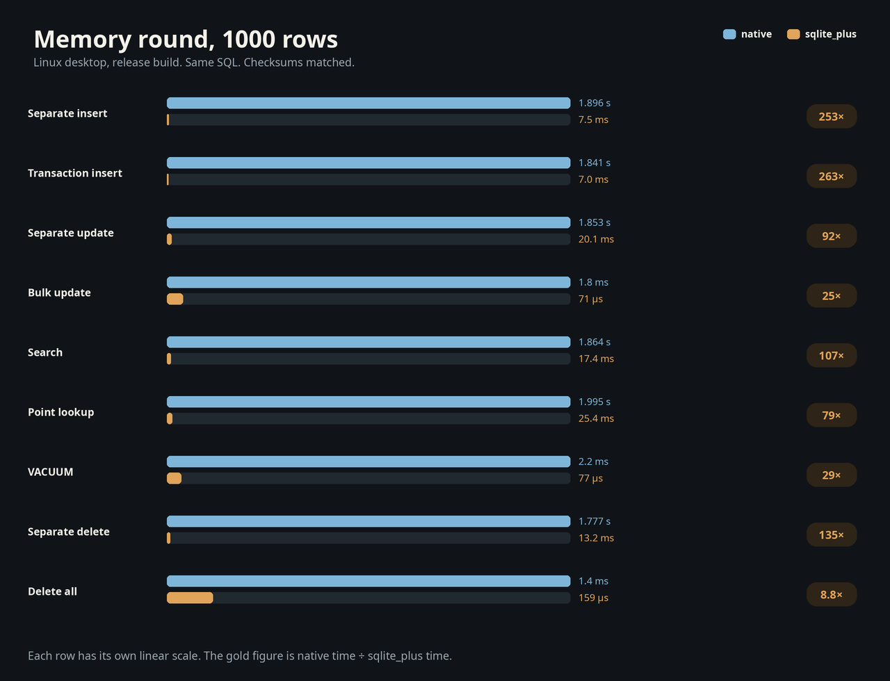
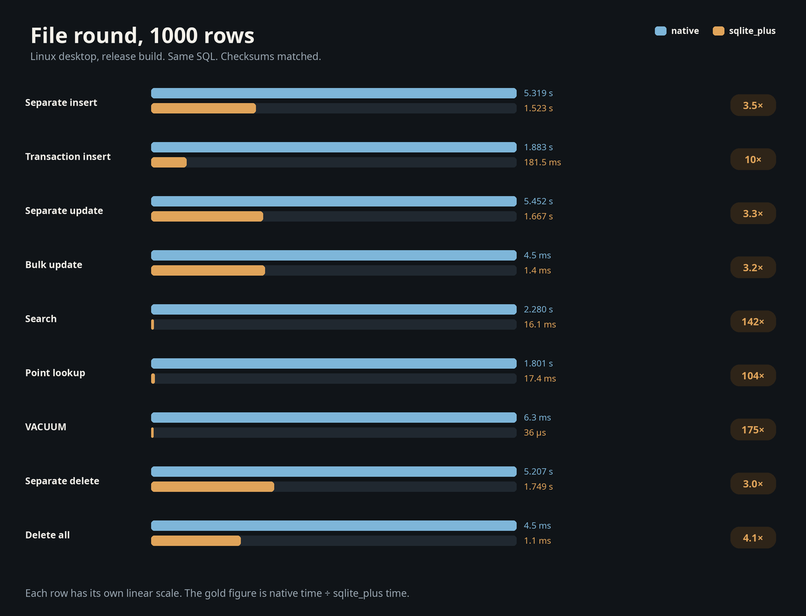

# sqlite_plus

SQL, JSON, full-text search, and R-tree in Dart. No FFI, no native SQLite, and no WASM in the production runtime.

```yaml
dependencies:
  sqlite_plus: ^0.1.3
```

## A table, a row, a query

```dart
import 'package:sqlite_plus/sqlite_plus.dart';

final db = await openInMemory();
await db.execute(
  'CREATE TABLE note (id INTEGER PRIMARY KEY, title TEXT, body TEXT)',
);
await db.execute(
  'INSERT INTO note(title, body) VALUES (?, ?), (?, ?)',
  ['Kept Garden', 'a garden kept in the margin', 'Other Atlas', 'south'],
);
final rows = await db.query(
  'SELECT title FROM note WHERE title LIKE ? ORDER BY title',
  ['%Garden%'],
);
```

`rows` is `Kept Garden`. Integers come back as `BigInt`. Parameters are `?`, `:name`, `@name`, and `$name`.

## JSON, search, and a place

```dart
await db.execute(
  'CREATE TABLE book (id INTEGER PRIMARY KEY, card TEXT NOT NULL)',
);
await db.execute(
  'INSERT INTO book(card) VALUES (json_object(?, ?, ?, ?))',
  ['title', 'Kept Garden', 'pages', 320],
);
final pages = await db.query(
  'SELECT json_extract(card, ?) FROM book WHERE json_extract(card, ?) = ?',
  [r'$.pages', r'$.title', 'Kept Garden'],
);

await db.execute('CREATE VIRTUAL TABLE book_text USING fts5(title, body)');
await db.execute(
  'INSERT INTO book_text(title, body) VALUES (?, ?)',
  ['Kept Garden', 'a garden kept in the margin'],
);
final hit = await db.query(
  "SELECT highlight(book_text, 1, '[', ']') FROM book_text WHERE book_text MATCH ?",
  ['kept'],
);

await db.execute(
  'CREATE VIRTUAL TABLE shelf USING rtree(id, minX, maxX, minY, maxY)',
);
await db.execute('INSERT INTO shelf VALUES (1, 0, 1, 0, 1)');
final place = await db.query(
  'SELECT id FROM shelf WHERE minX <= 1 AND maxX >= 0 AND minY <= 1 AND maxY >= 0',
);
```

`pages` is `320`. `hit` is `a garden [kept] in the margin`. `place` is shelf `1`.

## A function, a rollback, a reopen

```dart
db.functions.registerScalar(
  'twice',
  1,
  (args) => args.single == null ? null : (args.single as BigInt) * BigInt.two,
);
final doubled = await db.query('SELECT twice(?)', [21]);

await db.execute('BEGIN');
await db.execute(
  'INSERT INTO note(title, body) VALUES (?, ?)',
  ['Rolled Back', 'gone'],
);
await db.execute('ROLLBACK');

await db.execute('PRAGMA user_version = 7');
final again = await MutableSqliteDatabase.fromImage(db.exportImage());
```

`doubled` is `42`. The rolled-back row is gone. `again` opens the same image at `user_version` 7.

## A file

```dart
import 'package:sqlite_plus/sqlite_plus_io.dart';

final owner = await openDatabase(path, directoryEntriesDurable: true);
final version = await owner.client.query('PRAGMA user_version');
await owner.close();
```

`openDatabase` is `DatabaseOwner.open`. It needs `dart:io`. The file and its journal sidecar already exist. A second open of the same path fails while the first owner is open.

## Speed

1,000 rows on Linux, release build. The same SQL on both engines, and every checksum matched. Each bar is that row's measured time.



| Operation | native | sqlite_plus | faster |
|---|---:|---:|---:|
| Separate insert | 1.896 s | 7.5 ms | 253× |
| Transaction insert | 1.841 s | 7.0 ms | 263× |
| Separate update | 1.853 s | 20.1 ms | 92× |
| Bulk update | 1.8 ms | 71 µs | 25× |
| Search | 1.864 s | 17.4 ms | 107× |
| Point lookup | 1.995 s | 25.4 ms | 79× |
| VACUUM | 2.2 ms | 77 µs | 29× |
| Separate delete | 1.777 s | 13.2 ms | 135× |
| Delete all | 1.4 ms | 159 µs | 8.8× |

On a file, search was 142×, a point lookup 104×, and `VACUUM` 175×.



| Operation | native | sqlite_plus | faster |
|---|---:|---:|---:|
| Separate insert | 5.319 s | 1.523 s | 3.5× |
| Transaction insert | 1.883 s | 181.5 ms | 10× |
| Separate update | 5.452 s | 1.667 s | 3.3× |
| Bulk update | 4.5 ms | 1.4 ms | 3.2× |
| Search | 2.280 s | 16.1 ms | 142× |
| Point lookup | 1.801 s | 17.4 ms | 104× |
| VACUUM | 6.3 ms | 36 µs | 175× |
| Separate delete | 5.207 s | 1.749 s | 3.0× |
| Delete all | 4.5 ms | 1.1 ms | 4.1× |

The file size is taken before close, so it still includes the redo.

## SQL

| You write | You get |
|---|---|
| Joins | `INNER` `LEFT` `RIGHT` `FULL` `CROSS`, `ON`, `USING` |
| Shape | Subqueries, `EXISTS`, `IN`, `UNION`, `INTERSECT`, `EXCEPT`, CTEs, `GROUP BY`, `HAVING` |
| Windows | `ROW_NUMBER` `RANK` `DENSE_RANK` `LAG` `LEAD` `FIRST_VALUE` `LAST_VALUE` `NTH_VALUE` |
| Writes | `INSERT` `UPDATE` `DELETE`, `ON CONFLICT`, `RETURNING`, `BEGIN` `COMMIT` `ROLLBACK`, savepoints |
| Schema | Tables, indexes, views, triggers, `ALTER TABLE`, `CHECK`, `STRICT`, foreign keys, generated columns |
| JSON | `json` `jsonb` `json_pretty` `json_extract` `json_object` `json_set` `json_patch`, `->` `->>` |
| Search | FTS5 and contentless FTS4 `MATCH`, `highlight` `snippet` `bm25`, R-tree, geopoly |
| Your code | `registerScalar`, `registerAggregate`, `createCollation` |

`registerScalar` stays on that connection. `deterministic: true` allows it inside a schema expression. `registerAggregate` builds a fresh aggregate per group. `createCollation` sits beside `BINARY`, `NOCASE`, and `RTRIM`.

## The other packages

[`sqlite_plus_orm`](../sqlite_plus_orm) tracks the objects. A method on the class is a query.

```dart
@DbScalar()
BigInt? twice() => revision * BigInt.two;

final large = await books.query
    .selectWhere((row) => (row.twice() > 20) | row.title.upper().equalTo('WEST'))
    .toList();
```

`twice` reads `revision`. `upper` is this engine. [`sqlite_plus_generator`](../sqlite_plus_generator) writes `twice()` from that method.

```sh
dart run sqlite_plus_generator
```

From the package root this writes a part for every public `@DbEntity` and writes `lib/sqlite_plus_migrations.g.dart`. One library is still `dart run sqlite_plus_generator --input lib/models.dart`.

`openInMemory` is `MutableSqliteDatabase.create`. `exportImage` is the byte image a file can hold. `openBrowserStorage` reports `canRead`, `canWrite`, `durabilityPromised`, and `placement`.

Compared with pinned SQLite 3.53.1: constant `EXPLAIN` arithmetic, a constant `WHERE`, one table scan, a constant subquery, an integer-primary-key scan, `WITHOUT ROWID`, a virtual generated column, a typed `INSERT`, and a multi-row `VALUES` insert. An integer-primary-key insert and a join of two subqueries still have no bytecode. This is not a VDBE. Contentless FTS4 returns the pinned `MATCH` row and stores no content table. File `journal_mode` `wal`, `persist`, and `truncate` follow the pinned header and journal bytes. This is not a multi-frame WAL. `incremental_vacuum` moves a live end page before truncating. ICU collations are absent. Correlated `json_each` matches the pinned CLI, including `json_each(docs.label) RIGHT JOIN docs`, which returns 0 rows. Set `doubleQuotedStrings` to treat an unresolved double-quoted identifier as a string. The default is off. The comparison is `db_browser_b3_dqs_test.dart`. Unquoted `a.title` beside a column named `a.title` returns the `title` column.
