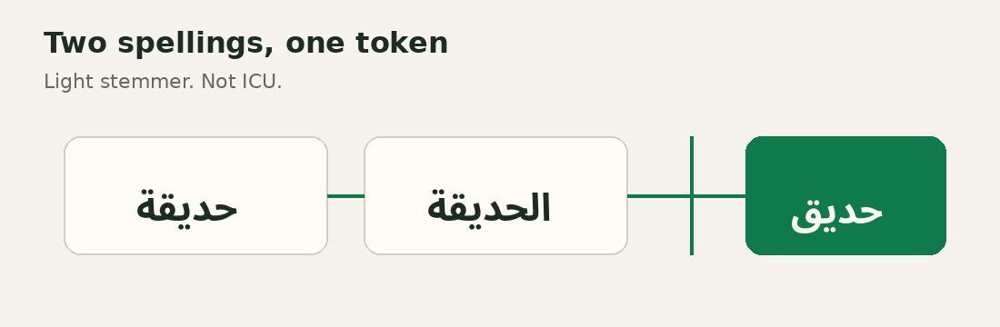

# sqlite_plus_arabic

A light Arabic stemmer for an FTS5 table in [`sqlite_plus`](https://pub.dev/packages/sqlite_plus). The name is the string `arabic`. Register it on the connection, then create the table with `tokenize = 'arabic'`.



```yaml
dependencies:
  sqlite_plus: ^0.1.14
  sqlite_plus_arabic: ^0.1.6
```

## What one word becomes

`ArabicTokenizers.arabic` is `'arabic'`. You can write that constant or the same characters by hand. The rules are fixed. The constructor rejects every option, so `tokenize = 'arabic remove_diacritics 1'` fails with `error in tokenizer constructor`.

Diacritics and tatweel are removed. Alef variants أ إ آ ٱ fold to ا. Alef maksura ى folds to ي. ئ folds to ي. ؤ folds to و. ASCII letters are lowercased and are not stemmed.

One prefix is removed when at least three letters remain, longest first: وال، بال، كال، فال، لل، ال. One suffix is then removed on the same condition: يات، ون، ين، ات، ان، ها، ية، يه، ه، ة، ي. When the word starts with one of those prefixes and removing it would leave fewer than three letters, the suffix stays as well. `الله` therefore stays `الله`.

| Text | Token |
|---|---|
| `حديقة` | `حديق` |
| `الحديقة` | `حديق` |
| `بالحديقة` | `حديق` |
| `والكتاب` | `كتاب` |
| `كتابه` | `كتاب` |
| `كِتَابٌ` | `كتاب` |
| `أحمد` | `احمد` |
| `الله` | `الله` |
| `Hello` | `hello` |

`في الحديقة` is two tokens, `في` and `حديق`. A string of commas produces no token. SQLite ICU Arabic is a different tokenizer. This package applies the list above.

## Folding text without an FTS table

`ArabicText.normalize` is the same light stemmer used on Arabic runs, plus folds the FTS tokenizer does not apply. It removes tatweel, the diacritics U+064B–U+065F and U+06D6–U+06ED, and U+0670. Alef variants fold to ا. Arabic-Indic digits `١٢٣` and `۴۵۶` fold to `123` and `456`. `foldYa` maps ى to ي. `foldHamza` maps ؤ to و and ئ to ي. Those two options default to ya folded and hamza kept.

`stem: true` runs `ArabicTokenizer` on Arabic runs only. Greek, CJK, and ASCII stay in the string and are not stemmed. With stemming, the tokenizer's fixed ya and hamza folds apply to those Arabic runs. `الحديقة حديقة الله Milk 中文 Ελληνικά` becomes `حديق حديق الله milk 中文 ελληνικά`.

This does not register a tokenizer and it does not change `tokenize = 'arabic'`. The FTS tokenizer still recognizes only Arabic and ASCII, so a mixed FTS index should keep `unicode61` and fold the text first.

## SQL

Register before `CREATE`. The registry is the connection's. A second `register` replaces the factory. `SqlitePlusArabic.register` accepts a `SqliteDatabase`, a `MutableSqliteDatabase`, or that connection's `SqlFunctionRegistry`.

```dart
import 'dart:io';

import 'package:sqlite_plus/sqlite_plus_io.dart';
import 'package:sqlite_plus_arabic/sqlite_plus_arabic.dart';

final db = await openFileImage('garden.db');
SqlitePlusArabic.register(db);
await db.execute(
  "CREATE VIRTUAL TABLE docs USING fts5(body, tokenize = 'arabic')",
);
await db.execute(
  'INSERT INTO docs(body) VALUES (?), (?)',
  ['في الحديقة', 'سيارة'],
);
final found = await db.query(
  "SELECT body FROM docs WHERE docs MATCH 'حديقة'",
);
final missed = await db.query(
  "SELECT body FROM docs WHERE docs MATCH 'كتاب'",
);
await File('garden.db').writeAsBytes(db.exportImage(), flush: true);
```

`found` is one row, `في الحديقة`. `MATCH 'الحديقة'` and `MATCH 'حديق'` return that same row, because all three strings share `حديق`. `missed` is empty: `سيارة` does not share a token with `حديقة`.

Creating the table before `register` fails with `no such tokenizer: arabic`. The database stays usable. Call `register`, then run the `CREATE` again.

`openFileImage` reads `garden.db`, or starts empty when that file is missing. `exportImage` writes it back. The next open has an empty tokenizer registry, so call `SqlitePlusArabic.register` again before the next `MATCH`.

[`sqlite_plus`](https://pub.dev/packages/sqlite_plus) stores the FTS5 index and answers `MATCH`, `highlight`, `snippet`, and `bm25`. This package only supplies the tokenizer named `arabic`.

## A mapped table

[`sqlite_plus_orm`](https://pub.dev/packages/sqlite_plus_orm) stores the tokenizer name on the entity. It does not import this package. `DbModules.fts5` is the string `'fts5'`. `ArabicTokenizers.arabic` is the string `'arabic'`. `module: 'fts5'` and `tokenizer: 'arabic'` are the same two values written by hand.

```dart
import 'package:sqlite_plus_arabic/sqlite_plus_arabic.dart';
import 'package:sqlite_plus_orm/sqlite_plus_orm.dart';

@DbEntity(module: DbModules.fts5, tokenizer: ArabicTokenizers.arabic)
class Note {
  Note({this.rowid, required this.body});

  @DbKey(generated: true)
  final BigInt? rowid;
  final String body;
}
```

The key column is `rowid`. Every other mapped column is text. A tokenizer on `DbModules.rtree` or on an ordinary table is rejected, because only FTS5 has a `tokenize` clause.

```dart
import 'dart:io';

import 'package:sqlite_plus/sqlite_plus_io.dart';
import 'package:sqlite_plus_orm/sqlite_plus_orm.dart';

final database = await openFileImage('garden.db');
final connection = MutableDatabaseConnection(database, closeDatabase: true);
SqlitePlusArabic.register(connection.database);
final context = DbContext(connection, generatedModel);
await context.migrations.ensureCreated();

final notes = context.set(NoteMapping.instance);
notes.add(Note(body: 'في الحديقة'));
notes.add(Note(body: 'كتاب بعيد'));
await context.saveChanges(); // 2
await File('garden.db').writeAsBytes(database.exportImage(), flush: true);

final found = await notes.query.search('الحديقة').single();
final missed = await notes.query.search('سيارة').toList();
final again = await context.migrations.plan();
```

`ensureCreated` writes `CREATE VIRTUAL TABLE "Note" USING fts5("body", tokenize = 'arabic')`. `found.body` is `في الحديقة`. `missed` is empty. `again` is empty: the stored virtual SQL still matches the model. Register before `ensureCreated`. A search on an unregistered connection fails with `no such tokenizer: arabic`.

A hand-written mapping uses the same two strings:

```dart
final type = EntityType<Note>(
  tableName: 'notes',
  columns: [rowid, body],
  virtualModule: DbModules.fts5,
  tokenizer: ArabicTokenizers.arabic,
  create: (row) => Note(rowid: row.read(rowid), body: row.read(body)),
);
```

`notes.query.search('الحديقة')` is the same full-text query. The column codec stays `Codecs.text`.

## What the generator writes

[`sqlite_plus_generator`](https://pub.dev/packages/sqlite_plus_generator) reads `DbModules.fts5` and `ArabicTokenizers.arabic` as strings. The part contains `virtualModule: "fts5"`, `tokenizer: "arabic"`, and `search(String text)`. It does not import `sqlite_plus_arabic`. The application still calls `SqlitePlusArabic.register` before `ensureCreated`.

```dart
final note =
    (await NoteQuery(notes.query).search('الحديقة').toList()).single;
```

`note.body` is `في الحديقة`. `search('سيارة')` returns no row. The generator guide shows the surrounding class and the package model.

## The runnable example

`packages/sqlite_plus_arabic/example` is that mapped table, with two saved notes.

```sh
cd packages/sqlite_plus_arabic/example
dart run bin/main.dart
```

```text
في الحديقة | missed true | stable true
```

`في الحديقة` is the body found by `search('الحديقة')`. `missed true` means `search('سيارة')` returned no row. `stable true` means a second `plan()` is empty.

## Where each piece lives

| You want | Package | You call |
|---|---|---|
| The index, `MATCH`, `highlight` | [`sqlite_plus`](https://pub.dev/packages/sqlite_plus) | `garden.db`, then SQL |
| The string constants and `search` | [`sqlite_plus_orm`](https://pub.dev/packages/sqlite_plus_orm) | `DbModules.fts5`, `notes.query.search` |
| The class turned into a part | [`sqlite_plus_generator`](https://pub.dev/packages/sqlite_plus_generator) | `dart run sqlite_plus_generator` |
| The stemmer and `ArabicText.normalize` | this package | `SqlitePlusArabic.register`, `ArabicText.normalize` |

## The packages on pub.dev

Each package is a complete library. Import only what you call. The links below are the package pages.

| Package | Version | Page |
|---|---|---|
| sqlite_plus | `^0.1.14` | <https://pub.dev/packages/sqlite_plus> |
| sqlite_plus_orm | `^0.1.12` | <https://pub.dev/packages/sqlite_plus_orm> |
| sqlite_plus_generator | `^0.1.12` | <https://pub.dev/packages/sqlite_plus_generator> |
| sqlite_plus_arabic | `^0.1.6` | <https://pub.dev/packages/sqlite_plus_arabic> |
| sqlite_plus_vec | `^0.1.6` | <https://pub.dev/packages/sqlite_plus_vec> |
| sqlite_plus_geo | `^0.1.5` | <https://pub.dev/packages/sqlite_plus_geo> |

### sqlite_plus

```yaml
dependencies:
  sqlite_plus: ^0.1.14
```

```dart
import 'package:sqlite_plus/sqlite_plus_io.dart';

final db = await openDatabase('shelf.db');
await db.execute(
  'CREATE TABLE IF NOT EXISTS note (id INTEGER PRIMARY KEY, title TEXT)',
);
await db.insert('note', {'title': 'Kept Garden'});
final rows = await db.query(
  'note',
  columns: ['title'],
  where: 'title LIKE ?',
  whereArgs: ['%Garden%'],
);
```

The title is `Kept Garden`. A missing `shelf.db` is created. The next launch opens the same file. Integers come back as `BigInt`. There is no FFI and no native SQLite in this engine.


### sqlite_plus_orm

```yaml
dependencies:
  sqlite_plus_orm: ^0.1.12
```

```dart
import 'package:sqlite_plus_orm/sqlite_plus_orm.dart';

@DbEntity()
class Note {
  Note({this.id, required this.title, this.revision = 0});
  final BigInt? id;
  String title;
  @DbVersion()
  int revision;
}
```

`saveChanges` writes one transaction and bumps `revision`. A table with no `PRIMARY KEY` still maps. Its key is the SQLite row id:

```dart
@DbKey(generated: true)
final BigInt? rowid;
```

`plan()` adopts that row id and does not rebuild the table.

### sqlite_plus_generator

```yaml
dev_dependencies:
  sqlite_plus_generator: ^0.1.12
```

```sh
dart run sqlite_plus_generator
```

From the package root, that command writes a part for every public `@DbEntity` under `lib/`, plus `lib/sqlite_plus_migrations.g.dart`.

### sqlite_plus_arabic

```yaml
dependencies:
  sqlite_plus_arabic: ^0.1.6
```

```dart
import 'package:sqlite_plus_arabic/sqlite_plus_arabic.dart';

SqlitePlusArabic.register(db);
await db.execute(
  "CREATE VIRTUAL TABLE passage USING fts5(body, tokenize = 'arabic')",
);
```

`حديقة` and `الحديقة` share one token. `الله` stays `الله`. This is not the SQLite ICU Arabic tokenizer. Register before `CREATE`, and again after the image is reopened.

### sqlite_plus_vec

```yaml
dependencies:
  sqlite_plus_vec: ^0.1.6
```

```dart
import 'package:sqlite_plus_vec/sqlite_plus_vec.dart';

SqlitePlusVec.register(db);
await db.execute(
  'CREATE VIRTUAL TABLE point USING vec0(embedding float[2] distance_metric=l2)',
);
```

`MATCH` with `k` scans every stored float32 vector. The file is not a sqlite-vec database.

### sqlite_plus_geo

```yaml
dependencies:
  sqlite_plus_geo: ^0.1.5
```

```dart
import 'package:sqlite_plus_geo/sqlite_plus_geo.dart';

final geo = GeoSession(db);
await geo.createSpatialTable(
  'facilities',
  geometryColumn: 'location',
  geometryType: GeoGeometryType.point,
  srid: 4326,
);
```

X is longitude and Y is latitude. `ST_SetSRID` only labels a geometry. `ST_Transform` moves a coordinate between EPSG:4326, EPSG:3857, and WGS84 UTM. A degree is not a metre. This is not an OGC, PostGIS, SpatiaLite, or GeoPackage certification.


An application that does not import this package does not load the stemmer. The engine keeps `unicode61`, `porter`, `trigram`, `ascii`, and `simple`. Those names stay fixed.
