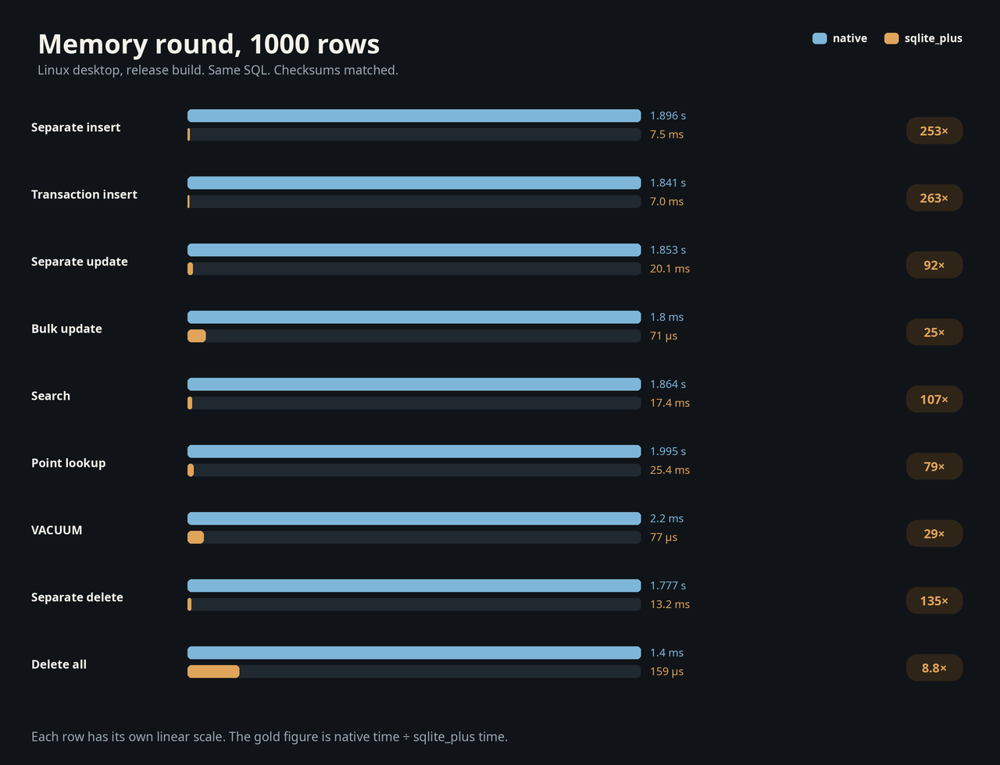
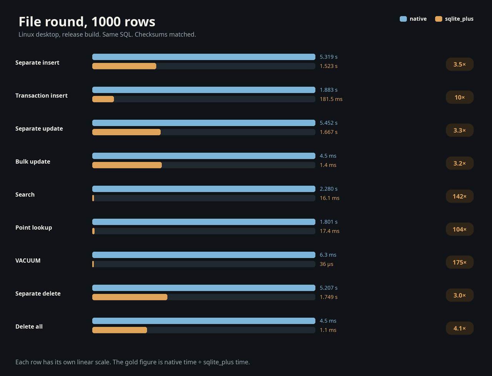

# sqlite_plus_generator

Write the class. This tool writes the columns, the revision, the JSON path, the full-text search, and the R-tree box. The analyzer stays on your machine. The application depends on `sqlite_plus_orm`.

```yaml
dev_dependencies:
  sqlite_plus_generator: ^0.1.12
```

## The classes

```dart
import 'package:sqlite_plus_orm/sqlite_plus_orm.dart';

part 'models.orm.g.dart';

class Customer {
  Customer({this.id, required this.name, this.revision = 0});
  final BigInt? id;
  final String name;
  @DbVersion()
  final int revision;
}

class Purchase {
  Purchase({this.id, this.customerId, required this.total});
  BigInt? id;
  BigInt? customerId;
  double total;
}

class Note {
  Note({this.id, required this.document});
  final BigInt? id;
  @DbJson()
  final String document;
}

@DbEntity(module: DbModules.fts5, tokenizer: DbTokenizers.porter)
class Article {
  Article({this.rowid, required this.body});
  @DbKey(generated: true)
  final BigInt? rowid;
  final String body;
}

@DbEntity(module: DbModules.vec0)
class Point {
  Point({this.rowid, required this.embedding});
  @DbKey(generated: true)
  final BigInt? rowid;
  @DbVector(4, metric: DbVectorMetrics.cosine)
  final List<double> embedding;
}

@DbEntity(module: 'rtree')
class Place {
  Place({
    required this.id,
    required this.minX,
    required this.maxX,
    required this.minY,
    required this.maxY,
  });
  final BigInt id;
  final double minX, maxX, minY, maxY;
}
```

`customerId` becomes `PurchaseRelationships.customer`. The part is `models.orm.g.dart`.

## What you call

```dart
final context = DbContext(connection, generatedModel);
await context.migrations.ensureCreated();

final purchases = context.set(PurchaseMapping.instance);
final ada = context.set(CustomerMapping.instance).add(Customer(name: 'Ada'));
final purchase = purchases.add(Purchase(total: 22.5));
purchases.add(Purchase(total: 4));
purchases.add(Purchase(total: 30));
purchase.reference(PurchaseRelationships.customer).set(ada);

final notes = context.set(NoteMapping.instance);
notes.add(Note(document: '{"title":"kept"}'));
final articles = context.set(ArticleMapping.instance);
articles.add(Article(body: 'alpha kept'));
final places = context.set(PlaceMapping.instance);
places.add(Place(id: BigInt.one, minX: 0, maxX: 1, minY: 0, maxY: 1));
await context.saveChanges();

final expensive = await purchases.query
    .selectWhere((row) => row.total > 20.0)
    .orderByFields((row) => [row.total.ascending])
    .select();
final large = await purchases.query
    .selectWhere((row) => row.total.abs() > 20)
    .toList();
final note = (await NoteQuery(notes.query)
        .filter((row) => row.path(r'$.title').equalTo('kept'))
        .toList())
    .single;
final article = (await ArticleQuery(articles.query).search('kept').toList()).single;
final inside = (await PlaceQuery(places.query)
        .filter((row) => row.bounds.intersects(
            const Rect(minX: 0, minY: 0, maxX: 1, maxY: 1)))
        .toList())
    .single;
final buyer = await purchase.reference(PurchaseRelationships.customer).load();
```

`expensive` is `22.5` then `30.0`. `large` is those same two rows: `abs` is the engine, called on the column. `note.document` is `{"title":"kept"}`. `article.body` is `alpha kept`. `inside` is place `1`. `buyer` is `Ada`.

A method on the class is a scalar too. It reads the fields. The query calls it with no arguments.

```dart
class Purchase {
  Purchase({this.id, this.customerId, required this.total});
  BigInt? id;
  BigInt? customerId;
  double total;

  @DbScalar()
  double doubled() => total * 2;
}

final matched = await purchases.query
    .selectWhere((row) => row.doubled() > 40)
    .toList();
```

`matched` is the 22.5 and 30 purchases: each total doubled is above 40. The part registers `purchase_doubled`.

## A card stored as one object

`@DbDocument()` is a class with `toJson` and `fromJson`. The column is `TEXT`. The part stores `Codecs.document` and a `DocumentField`, so the filter is `row.card.path`.

```dart
@DbEntity(table: 'notes')
class Note {
  Note({this.id, required this.card, this.revision = 0});

  final BigInt? id;
  @DbDocument()
  Card card;
  @DbVersion()
  int revision;
}

class Card {
  Card({required this.title, required this.pages});

  final String title;
  final int pages;

  Map<String, Object?> toJson() => {'title': title, 'pages': pages};

  factory Card.fromJson(Map<String, Object?> json) => Card(
    title: json['title']! as String,
    pages: json['pages']! as int,
  );
}
```

The part contains `DocumentField(NoteColumns.card)` and, on that column, `Codecs.document(Card.fromJson, (value) => value.toJson())`. `fromJson(Map<String, dynamic>)` is wrapped as `(Map<String, Object?> json) => Card.fromJson(Map<String, dynamic>.from(json))`. A `String` field still uses `@DbJson` and `row.path`.

```dart
final notes = context.set(NoteMapping.instance);
notes.add(Note(card: Card(title: 'Kept Garden', pages: 320)));
notes.add(Note(card: Card(title: 'Other Atlas', pages: 40)));
await context.saveChanges();
final kept = await notes.query
    .filter((row) => row.card.path(r'$.title').equalTo('Kept Garden'))
    .single();
```

`kept.card.pages` is 320. The SQL is `json_extract("card", ?) = ?`, with parameters `$.title` and `Kept Garden`. `Other Atlas` stays stored text. After `kept.card = Card(title: 'Kept Garden', pages: 321)` and another save, the next read has pages 321 and revision 1. The other note stays at revision 0.

## Arabic words and nearest vectors

`DbModules.fts5` and `'fts5'` both become `virtualModule: "fts5"`. `tokenizer: DbTokenizers.porter` becomes `tokenizer: "porter"`. `tokenizer: 'arabic'` becomes `tokenizer: "arabic"`. The part grows a `search` method either way.

```dart
import 'package:sqlite_plus_arabic/sqlite_plus_arabic.dart';
import 'package:sqlite_plus_orm/sqlite_plus_orm.dart';

@DbEntity(module: DbModules.fts5, tokenizer: ArabicTokenizers.arabic)
class Garden {
  Garden({this.rowid, required this.body});
  @DbKey(generated: true)
  final BigInt? rowid;
  final String body;
}
```

The part contains the mapping and the query method. It does not import `sqlite_plus_arabic`. `Garden` is a different class from the JSON `Note` above.

```dart
static final EntityType<Garden> instance = EntityType<Garden>(
  tableName: "Garden",
  columns: GardenColumns.all,
  create: _create,
  virtualModule: "fts5",
  tokenizer: "arabic",
  applyStoreValues: (entity, row) => _create(row),
);

extension GardenQuery on TypedQuery<Garden> {
  TypedQuery<Garden> search(String text) =>
      TypedQuery<Garden>(type: type, connection: connection).search(text);
}
```

`@DbEntity(module: DbModules.vec0)` with `@DbVector(2)` becomes `Codecs.vector(2)`, `vectorDimensions: 2`, `vectorMetric: "l2"`, and `nearest`. `@DbVector(4, metric: DbVectorMetrics.cosine)` stores `vectorMetric: "cosine"`. The default `k` on the generated method is 10.

```dart
extension PointQuery on TypedQuery<Point> {
  TypedQuery<Point> nearest(List<double> vector, {int k = 10}) =>
      TypedQuery<Point>(type: type, connection: connection)
          .nearest(vector, k: k);
}
```

The four-coordinate `Point` above is a different table: its metric is cosine and its list has length 4. The calls below use a two-coordinate class. [`sqlite_plus_arabic`](https://pub.dev/packages/sqlite_plus_arabic) supplies the stemmer. [`sqlite_plus_vec`](https://pub.dev/packages/sqlite_plus_vec) supplies `vec0`. [`sqlite_plus_orm`](https://pub.dev/packages/sqlite_plus_orm) defines `search` and `nearest`. The part still does not import either package.

```dart
import 'package:sqlite_plus_orm/sqlite_plus_orm.dart';

@DbEntity(module: DbModules.vec0)
class Neighbor {
  Neighbor({this.rowid, required this.embedding});
  @DbKey(generated: true)
  final BigInt? rowid;
  @DbVector(2)
  final List<double> embedding;
}
```

```dart
import 'dart:io';

import 'package:sqlite_plus/sqlite_plus_io.dart';
import 'package:sqlite_plus_orm/sqlite_plus_orm.dart';
import 'package:sqlite_plus_arabic/sqlite_plus_arabic.dart';
import 'package:sqlite_plus_vec/sqlite_plus_vec.dart';

final database = await openFileImage('library.db');
final connection = MutableDatabaseConnection(database, closeDatabase: true);
SqlitePlusArabic.register(connection.database);
SqlitePlusVec.register(connection.database);
final context = DbContext(connection, generatedModel);
await context.migrations.ensureCreated();

final gardens = context.set(GardenMapping.instance);
final neighbors = context.set(NeighborMapping.instance);
gardens.add(Garden(body: 'في الحديقة'));
gardens.add(Garden(body: 'سيارة'));
neighbors.add(Neighbor(embedding: const [1, 0]));
neighbors.add(Neighbor(embedding: const [0, 1]));
await context.saveChanges(); // 4
await File('library.db').writeAsBytes(database.exportImage(), flush: true);

final garden =
    (await GardenQuery(gardens.query).search('الحديقة').toList()).single;
final neighbor = (await NeighborQuery(neighbors.query)
        .nearest(const [0.9, 0.1], k: 1)
        .toList())
    .single;
```

`garden.body` is `في الحديقة`. `neighbor.embedding` is `[1.0, 0.0]`. A second `plan()` is empty. The garden table's SQL contains `tokenize = 'arabic'`. The neighbor table's SQL contains `float[2] distance_metric=l2`. `@DbVector(2)` omitted `metric`, so the metric is `l2`.

These annotations fail before a file is written:

| Source | Why |
|---|---|
| `module: 'fts4'` | The ORM cannot write that `CREATE VIRTUAL TABLE` |
| `module: DbModules.rtree` and `tokenizer: DbTokenizers.porter` | A tokenizer belongs on FTS5 |
| `tokenizer: 'arabic stem'` | The name has to be one SQL identifier |
| `@DbVector(4)` on an ordinary class or on `fts5` | A vector belongs on `vec0` |
| `module: DbModules.vec0` with no `@DbVector` | `vec0` has one vector column |
| `@DbVector(0)` or `@DbVector(4097)` | Dimensions run from 1 to 4096 |
| A `vec0` field named `distance` | `distance` and `k` are the hidden query columns |

After the first `ensureCreated`, a new nullable field is an up migration:

```sh
dart run sqlite_plus_generator --input lib/models.dart
```

```dart
final plan = await context.migrations.plan();
await context.migrations.applySafe(plan);
```

A renamed SQL column is not guessed. Keep `@DbColumn(name: 'title')` when only the Dart name changes. When the column itself changes, write the `ALTER` and approve that plan. The reverse statement is the down migration. The ORM page shows both.

## The engine underneath

1,000 rows on Linux, release build. The same SQL, and every checksum matched. In memory, a transaction of inserts was 263× and search was 107×. On a file, search was 142× and a point lookup was 104×.





## What the part contains

| You write | The part contains |
|---|---|
| A concrete public class | `EntityType`, columns, `filter`, `orderByFields` |
| `id` or `<ClassName>Id` | The primary key |
| `@DbColumn(name: ...)` | That SQL name |
| `@DbIgnore` | The field left out of the table |
| `@DbKey(generated: true)` | A key assigned on insert |
| `@DbVersion()` | The revision column |
| `<Parent>Id` or `@DbReference` | `reference` and `collection` |
| `@DbJson()` on one `String` | `path` |
| `@DbDocument()` on an object | `row.card.path`, stored with `fromJson` and `toJson` |
| `@DbScalar()` on a method or getter | `row.twice()`, registered as `table_method` |
| `@DbEntity(module: DbModules.fts5)` | `USING fts5` and `search`. `'fts5'` is the same string |
| `tokenizer: DbTokenizers.porter` or `tokenizer: 'arabic'` | `tokenize = 'porter'` or `tokenize = 'arabic'` |
| `@DbEntity(module: DbModules.rtree)` | `USING rtree` and `bounds` |
| `@DbEntity(module: DbModules.vec0)` and `@DbVector(4)` | `Codecs.vector(4)`, `float[4]`, and `nearest` |

The write is deterministic and formatted. Hand-written files and symbolic links stay in place. Fields are `int`, `BigInt`, `double`, `bool`, `String`, `Uint8List`, `DateTime`, and, on `vec0`, `List<double>`. Nullable aliases of the scalar types are included. `@DbDocument()` adds one class that has `fromJson` and `toJson`. A generic, an inherited field, or an unsupported type is reported before any file is written. An unknown module, a tokenizer on a table that is not FTS5, a vector off `vec0`, a dimension outside 1 to 4096, and a column named `distance` or `k` on `vec0` are reported the same way. The part does not import `sqlite_plus_arabic` or `sqlite_plus_vec`. The application registers those packages before it creates the tables.

## The other packages

[`sqlite_plus`](https://pub.dev/packages/sqlite_plus) runs the SQL and keeps it in a file:

```dart
import 'package:sqlite_plus/sqlite_plus_io.dart';

final db = await openDatabase('shelf.db');
await db.execute(
  'CREATE TABLE IF NOT EXISTS note (id INTEGER PRIMARY KEY, title TEXT)',
);
```

[`sqlite_plus_orm`](https://pub.dev/packages/sqlite_plus_orm) is what the application calls. `saveChanges` writes the tracked objects, and `row.doubled()` is the method above. `DbModules`, `DbTokenizers`, and `DbVectorMetrics` are the string constants in that package.

[`sqlite_plus_arabic`](https://pub.dev/packages/sqlite_plus_arabic) is registered with `SqlitePlusArabic.register` before a table whose tokenizer is `arabic` is created. `search('الحديقة')` then returns the garden note whose body is `في الحديقة`. [`sqlite_plus_vec`](https://pub.dev/packages/sqlite_plus_vec) is registered with `SqlitePlusVec.register` before a `vec0` table is created. `nearest(const [0.9, 0.1], k: 1)` then returns `[1.0, 0.0]` when the stored rows are `[1, 0]` and `[0, 1]`.

## The packages on pub.dev

Each package is a complete library. Import only what you call. The links below are the package pages.

| Package | Version | Page |
|---|---|---|
| sqlite_plus | `^0.1.13` | <https://pub.dev/packages/sqlite_plus> |
| sqlite_plus_orm | `^0.1.12` | <https://pub.dev/packages/sqlite_plus_orm> |
| sqlite_plus_generator | `^0.1.12` | <https://pub.dev/packages/sqlite_plus_generator> |
| sqlite_plus_arabic | `^0.1.6` | <https://pub.dev/packages/sqlite_plus_arabic> |
| sqlite_plus_vec | `^0.1.6` | <https://pub.dev/packages/sqlite_plus_vec> |
| sqlite_plus_geo | `^0.1.5` | <https://pub.dev/packages/sqlite_plus_geo> |

### sqlite_plus

```yaml
dependencies:
  sqlite_plus: ^0.1.13
```

```dart
import 'package:sqlite_plus/sqlite_plus_io.dart';

final db = await openDatabase('shelf.db');
await db.execute(
  'CREATE TABLE IF NOT EXISTS note (id INTEGER PRIMARY KEY, title TEXT)',
);
await db.insert('note', {'title': 'Kept Garden'});
final rows = await db.query(
  'note',
  columns: ['title'],
  where: 'title LIKE ?',
  whereArgs: ['%Garden%'],
);
```

The title is `Kept Garden`. A missing `shelf.db` is created. The next launch opens the same file. Integers come back as `BigInt`. There is no FFI and no native SQLite in this engine.


### sqlite_plus_orm

```yaml
dependencies:
  sqlite_plus_orm: ^0.1.12
```

```dart
import 'package:sqlite_plus_orm/sqlite_plus_orm.dart';

@DbEntity()
class Note {
  Note({this.id, required this.title, this.revision = 0});
  final BigInt? id;
  String title;
  @DbVersion()
  int revision;
}
```

`saveChanges` writes one transaction and bumps `revision`. A table with no `PRIMARY KEY` still maps. Its key is the SQLite row id:

```dart
@DbKey(generated: true)
final BigInt? rowid;
```

`plan()` adopts that row id and does not rebuild the table.

### sqlite_plus_generator

```yaml
dev_dependencies:
  sqlite_plus_generator: ^0.1.12
```

```sh
dart run sqlite_plus_generator
```

From the package root, that command writes a part for every public `@DbEntity` under `lib/`, plus `lib/sqlite_plus_migrations.g.dart`.

### sqlite_plus_arabic

```yaml
dependencies:
  sqlite_plus_arabic: ^0.1.6
```

```dart
import 'package:sqlite_plus_arabic/sqlite_plus_arabic.dart';

SqlitePlusArabic.register(db);
await db.execute(
  "CREATE VIRTUAL TABLE passage USING fts5(body, tokenize = 'arabic')",
);
```

`حديقة` and `الحديقة` share one token. `الله` stays `الله`. This is not the SQLite ICU Arabic tokenizer. Register before `CREATE`, and again after the image is reopened.

### sqlite_plus_vec

```yaml
dependencies:
  sqlite_plus_vec: ^0.1.6
```

```dart
import 'package:sqlite_plus_vec/sqlite_plus_vec.dart';

SqlitePlusVec.register(db);
await db.execute(
  'CREATE VIRTUAL TABLE point USING vec0(embedding float[2] distance_metric=l2)',
);
```

`MATCH` with `k` scans every stored float32 vector. The file is not a sqlite-vec database.

### sqlite_plus_geo

```yaml
dependencies:
  sqlite_plus_geo: ^0.1.5
```

```dart
import 'package:sqlite_plus_geo/sqlite_plus_geo.dart';

final geo = GeoSession(db);
await geo.createSpatialTable(
  'facilities',
  geometryColumn: 'location',
  geometryType: GeoGeometryType.point,
  srid: 4326,
);
```

X is longitude and Y is latitude. `ST_SetSRID` only labels a geometry. `ST_Transform` moves a coordinate between EPSG:4326, EPSG:3857, and WGS84 UTM. A degree is not a metre. This is not an OGC, PostGIS, SpatiaLite, or GeoPackage certification.


```sh
dart run sqlite_plus_generator
```

Run that from the package root. Put one entity in `lib/book.dart`. The annotation is the whole marker. The `part` directive is optional because the command adds it:

```dart
import 'package:sqlite_plus_orm/sqlite_plus_orm.dart';

@DbEntity()
class Book {
  Book({this.id, required this.title});
  final BigInt? id;
  final String title;
}
```

A second file, `lib/note.dart`, uses the same shape for `Note`. The command writes `lib/book.orm.g.dart` and `lib/note.orm.g.dart`, then `lib/sqlite_plus_migrations.g.dart`. That last library's `generatedModel` is every selected entity and foreign key. A class that only has an `id` field is not included.

The command prints each file as it reads it. A part whose source stamp still matches is left unchanged and is not generated again. A missing part is created. A changed class is updated. The run ends with a summary for the package, or for the one library passed to `--input`.

```text
Found Book in lib/book.dart. Already generated. Leaving lib/book.orm.g.dart unchanged.
Found Note in lib/note.dart.
Generating lib/note.orm.g.dart.
Created lib/note.orm.g.dart.

Summary for the package
Unchanged: lib/book.orm.g.dart (Book)
Created: lib/note.orm.g.dart (Note)
Updated: lib/sqlite_plus_migrations.g.dart (Book, Note)
```

```dart
import 'package:your_app/book.dart' hide generatedModel;
import 'package:your_app/note.dart' hide generatedModel;
import 'package:your_app/sqlite_plus_migrations.g.dart';

final context = DbContext(connection, generatedModel);
await context.migrations.ensureCreated();
final plan = await context.migrations.plan();
await context.migrations.applySafe(plan);
```

Each model library also defines `generatedModel` for its own tables. Hide those names and use the package model when one context owns every entity. A `@DbReference` still has to name a `@DbEntity` class in the same library. The package model copies those foreign keys.

`ensureCreated` creates the tables on an empty database. After that, `plan` and `applySafe` add a new nullable column. A rename or a destructive change still needs a reviewed plan.

One library stays available:

```sh
dart run sqlite_plus_generator --input lib/models.dart
```

`--check` compares the generated files with the files on disk and does not add a missing `part` directive. `--class Book` limits that one library. `--output` and `--class` need `--input`.
