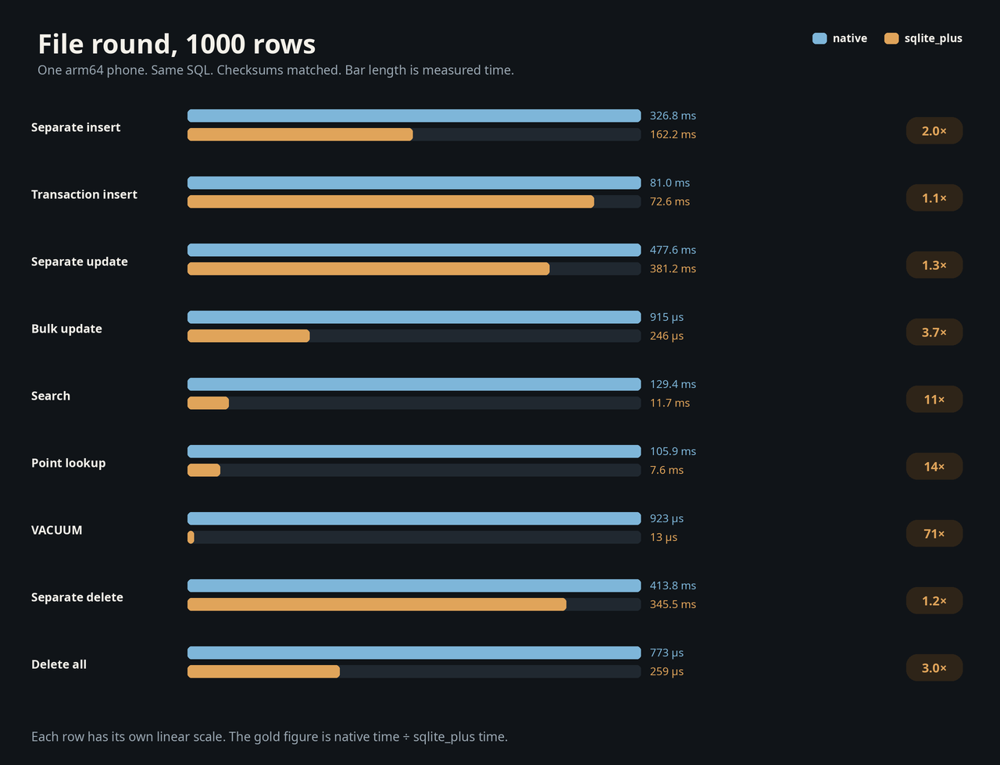
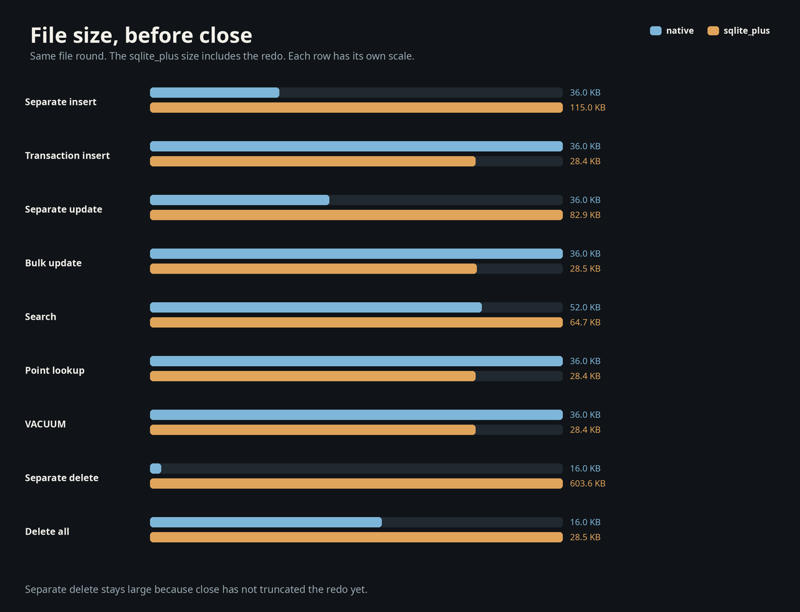

# sqlite_plus_generator

A development-time generator for `sqlite_plus_orm`. It reads Dart classes and writes columns, codecs, keys, revisions, relationships, JSON `path`, FTS5 `search`, and R-tree `bounds`. The generated application depends on `sqlite_plus_orm`. The analyzer stays in this development tool.

Version `0.0.2`.

The pictures below are the `sqlite_plus` engine, not this generator. One arm64 phone, Bench versionCode 2009, the file round, 1000 rows, Asia/Hebron 14:00 on 2026-10-29. The same SQL, checksums matched. Bar length is measured time, and each row has its own scale. The size is taken before close, so the sqlite_plus file still includes the redo.





## Install

```yaml
dev_dependencies:
  sqlite_plus_generator: ^0.0.2
```

The source file imports `sqlite_plus_orm` and declares `part 'models.orm.g.dart';`.

| Command | Effect |
|---|---|
| `dart run sqlite_plus_generator --input lib/models.dart` | Write the part |
| `--class Customer --class Purchase` | Map only those classes |
| `--output lib/models.orm.g.dart` | Set the part path |
| `--check` | Compare the part with the file on disk |

From this package directory:

```sh
dart run bin/sqlite_plus_generator.dart --input example/lib/models.dart --check
```

## What one class becomes

| You write | The part contains |
|---|---|
| A concrete public class | `EntityType`, columns, `filter`, `orderByFields` |
| `id` or `<ClassName>Id` | The primary key |
| `@DbColumn` | The SQL name |
| `@DbIgnore` | The field left out of the table |
| `@DbKey` | Key order, or `generated: true` |
| `@DbVersion()` | The revision column |
| `<Parent>Id` or `@DbReference` | `reference` and `collection` |
| `@DbJson()` on one `String` | `path(String path)` |
| `@DbEntity(module: 'fts5')` | `USING fts5` and `search(String text)` |
| `@DbEntity(module: 'rtree')` | `USING rtree` and `bounds` |

SQL names default to the exact Dart names. Annotations resolve by type identity and accept an import prefix. The write is deterministic, formatted, and replaced through a unique temporary file. Hand-written files and symbolic links stay in place.

## The library

`example/lib/models.dart` is the checked-in input. `example/lib/models.orm.g.dart` is the checked-in part.

| Class | Shape | Generated read |
|---|---|---|
| `Customer` | Generated `BigInt? id`, `name`, `@DbVersion() revision` | Relationship target |
| `Purchase` | Mutable `id`, `customerId`, `total` | `filter((row) => row.total > 20.0)` |
| `Note` | `@DbJson() document` | `path(r'$.title')` |
| `Article` | `@DbEntity(module: 'fts5')`, `@DbKey(generated: true) rowid`, `body` | `search('kept')` |
| `Place` | `@DbEntity(module: 'rtree')`, integer `id`, four doubles | `bounds.intersects` |

```dart
class Customer {
  Customer({this.id, required this.name, this.revision = 0});
  final BigInt? id;
  final String name;
  @DbVersion()
  final int revision;
}

class Purchase {
  Purchase({this.id, this.customerId, required this.total});
  BigInt? id;
  BigInt? customerId;
  double total;
}

class Note {
  Note({this.id, required this.document});
  final BigInt? id;
  @DbJson()
  final String document;
}

@DbEntity(module: 'fts5')
class Article {
  Article({this.rowid, required this.body});
  @DbKey(generated: true)
  final BigInt? rowid;
  final String body;
}

@DbEntity(module: 'rtree')
class Place {
  Place({
    required this.id,
    required this.minX,
    required this.maxX,
    required this.minY,
    required this.maxY,
  });
  final BigInt id;
  final double minX, maxX, minY, maxY;
}
```

`Purchase.customerId` becomes `PurchaseRelationships.customer`. The FTS key is `rowid`. The R-tree key is the integer `id`, followed by `minX`, `maxX`, `minY`, and `maxY`.

## Ten rows, four reads

`example/lib/library_app.dart` imports the ORM and `models.dart`. It opens memory, calls `ensureCreated`, and saves one customer, three purchases, two notes, two articles, and two places.

| Read | Stored values | Result |
|---|---|---|
| `filter((row) => row.total > 20.0)` then `orderByFields` | `22.5`, `4`, `30` | `[22.5, 30.0]`, count `2` |
| `path(r'$.title').equalTo('kept')` | `kept`, `other` | `{"title":"kept"}` |
| `search('kept')` | `alpha kept`, `beta lost` | `alpha kept` |
| `bounds.intersects` on the unit box | place `1` and place `2` | place `1` of `2` |
| `reference(...).load()` | purchase linked to `Ada` | `Ada` |
| Second `migrations.plan()` | schema matches `generatedModel` | empty |

`saveChanges` returns `10`.

```dart
final matched = purchases.query
    .filter((row) => row.total > 20.0)
    .orderByFields((row) => [row.total.ascending]);
final note = (await NoteQuery(notes.query)
        .filter((row) => row.path(r'$.title').equalTo('kept'))
        .toList())
    .single;
final article =
    (await ArticleQuery(articles.query).search('kept').toList()).single;
final inside = await PlaceQuery(places.query)
    .filter((row) => row.bounds.intersects(
        const Rect(minX: 0, minY: 0, maxX: 1, maxY: 1)))
    .toList();
final buyer = await purchase.reference(PurchaseRelationships.customer).load();
```

From a checkout, after `dart pub get` at the repository root:

```sh
cd example
dart run sqlite_plus_generator --input lib/models.dart --check
dart run bin/main.dart
```

```text
Ada bought [22.5, 30.0]; {"title":"kept"}; alpha kept; place 1 of 2
```

## Field rules

| Field | Accepted |
|---|---|
| `int`, `BigInt`, `double`, `bool`, `String`, `Uint8List`, `DateTime` | Yes, including nullable aliases |
| Constructor | Must be able to rebuild persisted state |
| Mutable field | Assigned after construction |
| Immutable generated key | Reconstructed after save |
| Nullable assigned key | A non-null value when the entity is tracked |
| Composite key | Yes |
| Composite relationship, custom codec, index | Manual metadata on `sqlite_plus_orm` |

| Diagnostic | Examples |
|---|---|
| Located, before any write | Generic, inherited, or mixin storage |
| Located, before any write | Collection fields, unsupported types, ambiguous constructors, unmappable final state |

Tests cover golden output, conventions, annotations, aliases, constructors, diagnostics, CLI ownership, and compiled consumers. Those consumers run migrations, linked CRUD, revisions, queries, relationships, and a reopen. The tool resolves `analyzer` 14 and `dart_style` 3. The ORM runtime depends on `sqlite_plus`.

## Where the generated code runs

The generator stays on the development machine. The ORM runtime it writes was executed on Android 15, API 35, `x86_64`: two inserts, one revision update, and an idle save of `0`. The line is `packages/sqlite_plus/tool/android_probe_api35_x86_64.log`. An iOS simulator run is planned.

## Planned

| Area | Next |
|---|---|
| Storage | A durable browser store |
| Platforms | iOS |
| SQL | `json_pretty`, correlated `json_each`, EXPLAIN bytecode, STAT4, `auto_vacuum`, a durable two-database commit, more journal modes, extended FTS, ICU and locale collations |
| Scale | Benchmarks at 100000 and 1000000 rows |
