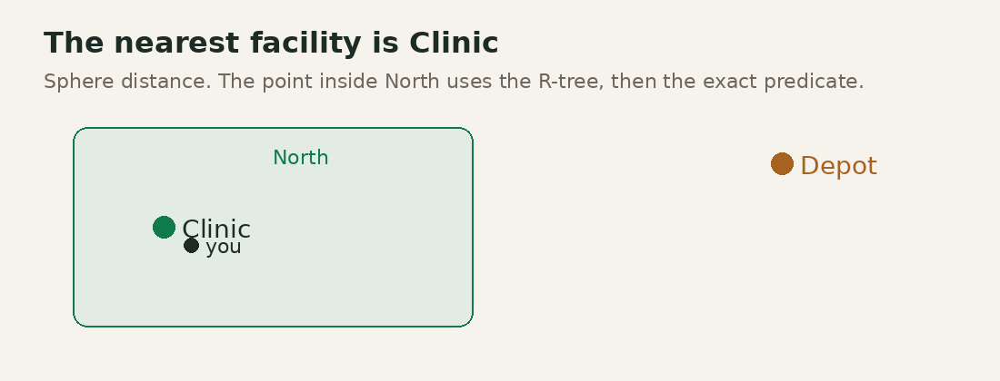

# sqlite_plus_geo

Pure Dart geometry, spatial SQL, and R-tree queries for [`sqlite_plus`](https://pub.dev/packages/sqlite_plus). The package does not use FFI, GEOS, GDAL, PROJ, SpatiaLite, or a native SQLite extension.

It is not an OGC, PostGIS, SpatiaLite, or GeoPackage certification. The functions that are registered are implemented and tested. Names that are not registered are listed in `SqlitePlusGeo.unsupported` and in [doc/LIMITATIONS.md](doc/LIMITATIONS.md).

## Install

```yaml
dependencies:
  sqlite_plus: ^0.1.13
  sqlite_plus_orm: ^0.1.12
  sqlite_plus_geo: ^0.1.5
```

The package page is <https://pub.dev/packages/sqlite_plus_geo>.



## Five minutes

```dart
import 'dart:io';

import 'package:sqlite_plus/sqlite_plus_io.dart';
import 'package:sqlite_plus_geo/sqlite_plus_geo.dart';

final database = await openFileImage('places.db');
final geo = GeoSession(database);
await geo.createSpatialTable(
  'facilities',
  geometryColumn: 'location',
  geometryType: GeoGeometryType.point,
  srid: 4326,
);
await geo.insert(
  'facilities',
  geometryColumn: 'location',
  geometry: GeoPoint(longitude: 34.30, latitude: 31.35, srid: 4326),
  values: {'name': 'Clinic'},
);
final nearby = await geo.nearest(
  'facilities',
  geometryColumn: 'location',
  point: GeoPoint(longitude: 34.31, latitude: 31.36, srid: 4326),
  limit: 10,
  maxDistance: 5000,
  metric: GeodesicModel.sphere,
);
await File('places.db').writeAsBytes(database.exportImage(), flush: true);
```

`openFileImage` reads `places.db` in this process, or starts empty when the file is missing. `GeoSession` registers its functions on that connection. `exportImage` writes the file back.

`GeodesicModel.sphere` measures metres on the authalic sphere. `GeodesicModel.planar` measures the stored axes and must not be read as metres on SRID 4326. `ST_DWithin(a, b, distance)` is planar. `ST_DWithin(a, b, metres, 1)` is spheroidal and accepts points.

X is longitude and Y is latitude. The package does not swap them.

## What is implemented

- Point, line, polygon, multi-geometries, and collections, with XY, XYZ, XYM, and XYZM.
- WKT, EWKT, WKB, EWKB, and RFC 7946 GeoJSON.
- DE-9IM predicates, planar measures, polygonal overlay, polygonal buffers, convex hull, and point concave hull.
- WGS84 geodesy: haversine, Vincenty distance and destination, spherical polygon area.
- EPSG:4326, EPSG:3857, and WGS84 UTM zones 32601–32660 and 32701–32760.
- Spatial columns stored as EWKB, indexed by sqlite_plus `rtree`, with savepoints, validation, and rebuild.
- Dart `search`, `nearest`, and `join`. SQL functions are registered on the connection. `EXPLAIN QUERY PLAN` does not show the spatial index; `SpatialPlan.describe()` does.
- A runtime ORM codec in `sqlite_plus_geo/orm.dart`. The generator does not emit it.
- Streaming GeoJSON and CSV import, and GeoJSON export.

## Examples

```sh
cd packages/sqlite_plus_geo/example && dart run bin/main.dart
```

The program prints the nearest facility, the zone that contains the sample point, the imported feature count, the intersection area, and whether the zone query used the index. The four demos are in `example/lib/demos.dart`.

## Documentation

| Guide | What it covers |
|---|---|
| [doc/ARCHITECTURE.md](doc/ARCHITECTURE.md) | Engine extension points and what this package does not change |
| [doc/GEOMETRY.md](doc/GEOMETRY.md) | Types, equality, validity, serialization |
| [doc/SPATIAL_SQL.md](doc/SPATIAL_SQL.md) | Registered SQL functions |
| [doc/SPATIAL_INDEXING.md](doc/SPATIAL_INDEXING.md) | R-tree storage and query plans |
| [doc/GEODESY.md](doc/GEODESY.md) | Sphere and ellipsoid |
| [doc/CRS.md](doc/CRS.md) | Built-in projections |
| [doc/PRECISION.md](doc/PRECISION.md) | Exact orientation and floating overlay |
| [doc/ORM.md](doc/ORM.md) | `GeoPointCodec` |
| [doc/PERFORMANCE.md](doc/PERFORMANCE.md) | The 1,000-point measurement |
| [doc/TESTING.md](doc/TESTING.md) | How to run the suite |
| [doc/COMPATIBILITY.md](doc/COMPATIBILITY.md) | Differences from PostGIS |
| [doc/LIMITATIONS.md](doc/LIMITATIONS.md) | Unsupported operations |

## Tests

From `packages/sqlite_plus_geo`, on Dart 3.13.7, Linux x64:

```sh
dart format .
dart analyze --fatal-infos
dart test
```

`dart test` passed 42 tests. The example passed 1 test and `dart run bin/main.dart` printed `Clinic | North | 2 | 2.0 | true`. macOS, Windows, Android, iOS, and Flutter web were not launched for this package.

## The packages on pub.dev

Each package is a complete library. Import only what you call. The links below are the package pages.

| Package | Version | Page |
|---|---|---|
| sqlite_plus | `^0.1.13` | <https://pub.dev/packages/sqlite_plus> |
| sqlite_plus_orm | `^0.1.12` | <https://pub.dev/packages/sqlite_plus_orm> |
| sqlite_plus_generator | `^0.1.12` | <https://pub.dev/packages/sqlite_plus_generator> |
| sqlite_plus_arabic | `^0.1.6` | <https://pub.dev/packages/sqlite_plus_arabic> |
| sqlite_plus_vec | `^0.1.6` | <https://pub.dev/packages/sqlite_plus_vec> |
| sqlite_plus_geo | `^0.1.5` | <https://pub.dev/packages/sqlite_plus_geo> |

### sqlite_plus

```yaml
dependencies:
  sqlite_plus: ^0.1.13
```

```dart
import 'package:sqlite_plus/sqlite_plus_io.dart';

final db = await openDatabase('shelf.db');
await db.execute(
  'CREATE TABLE IF NOT EXISTS note (id INTEGER PRIMARY KEY, title TEXT)',
);
await db.insert('note', {'title': 'Kept Garden'});
final rows = await db.query(
  'note',
  columns: ['title'],
  where: 'title LIKE ?',
  whereArgs: ['%Garden%'],
);
```

The title is `Kept Garden`. A missing `shelf.db` is created. The next launch opens the same file. Integers come back as `BigInt`. There is no FFI and no native SQLite in this engine.


### sqlite_plus_orm

```yaml
dependencies:
  sqlite_plus_orm: ^0.1.12
```

```dart
import 'package:sqlite_plus_orm/sqlite_plus_orm.dart';

@DbEntity()
class Note {
  Note({this.id, required this.title, this.revision = 0});
  final BigInt? id;
  String title;
  @DbVersion()
  int revision;
}
```

`saveChanges` writes one transaction and bumps `revision`. A table with no `PRIMARY KEY` still maps. Its key is the SQLite row id:

```dart
@DbKey(generated: true)
final BigInt? rowid;
```

`plan()` adopts that row id and does not rebuild the table.

### sqlite_plus_generator

```yaml
dev_dependencies:
  sqlite_plus_generator: ^0.1.12
```

```sh
dart run sqlite_plus_generator
```

From the package root, that command writes a part for every public `@DbEntity` under `lib/`, plus `lib/sqlite_plus_migrations.g.dart`.

### sqlite_plus_arabic

```yaml
dependencies:
  sqlite_plus_arabic: ^0.1.6
```

```dart
import 'package:sqlite_plus_arabic/sqlite_plus_arabic.dart';

SqlitePlusArabic.register(db);
await db.execute(
  "CREATE VIRTUAL TABLE passage USING fts5(body, tokenize = 'arabic')",
);
```

`حديقة` and `الحديقة` share one token. `الله` stays `الله`. This is not the SQLite ICU Arabic tokenizer. Register before `CREATE`, and again after the image is reopened.

### sqlite_plus_vec

```yaml
dependencies:
  sqlite_plus_vec: ^0.1.6
```

```dart
import 'package:sqlite_plus_vec/sqlite_plus_vec.dart';

SqlitePlusVec.register(db);
await db.execute(
  'CREATE VIRTUAL TABLE point USING vec0(embedding float[2] distance_metric=l2)',
);
```

`MATCH` with `k` scans every stored float32 vector. The file is not a sqlite-vec database.

### sqlite_plus_geo

```yaml
dependencies:
  sqlite_plus_geo: ^0.1.5
```

```dart
import 'package:sqlite_plus_geo/sqlite_plus_geo.dart';

final geo = GeoSession(db);
await geo.createSpatialTable(
  'facilities',
  geometryColumn: 'location',
  geometryType: GeoGeometryType.point,
  srid: 4326,
);
```

X is longitude and Y is latitude. `ST_SetSRID` only labels a geometry. `ST_Transform` moves a coordinate between EPSG:4326, EPSG:3857, and WGS84 UTM. A degree is not a metre. This is not an OGC, PostGIS, SpatiaLite, or GeoPackage certification.


Dart SDK `>=3.6.0 <4.0.0`. Flutter uses the same Dart library. Map widgets stay outside this package. `sqlite_plus_geo/io.dart` uses `dart:io` and is the file helper; the core library accepts a byte stream instead.
