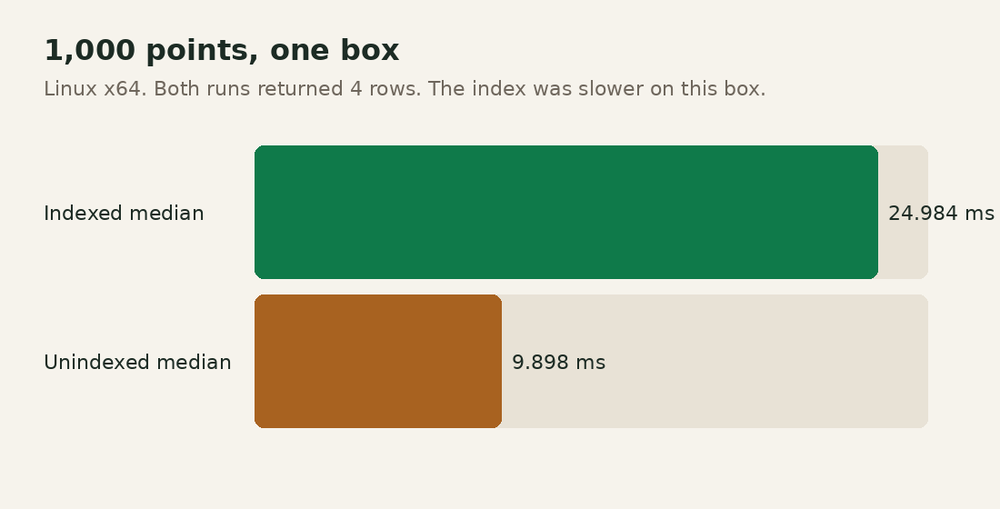

# Performance

One measurement was run. Sizes 10,000, 100,000, and 1,000,000 were not run.

| Field | Value |
|---|---|
| Host | Linux x64, Intel Xeon |
| Dart | 3.13.7 (stable) |
| Package | `sqlite_plus_geo` 0.1.0 on `sqlite_plus` 0.1.5 |
| Command | `dart run benchmark/bench.dart --size 1000` from `packages/sqlite_plus_geo` |
| Dataset | 1,000 uniform points in a 1000 by 1000 square, seed 20261104 |
| Query | polygon `(0,0)-(50,0)-(50,50)-(0,50)` |
| Iterations | 5 query repetitions after one insert |
| Result file | `benchmark/results/linux_x64_1000.json` |

Both runs returned 4 rows.

| Step | Indexed | Unindexed |
|---|---|---|
| Insert | 27,899,442 µs | 3,416,027 µs |
| Query samples, µs | 21524, 23053, 24984, 34426, 36254 | 8341, 8967, 9898, 10398, 10694 |
| Query median | 24,984 µs | 9,898 µs |
| Query max of the five | 36,254 µs | 10,694 µs |
| Candidates before the exact predicate | 4 | 1000 |

The process RSS after the run was 365,453,312 bytes. That is not a sampled peak.

The indexed query is the correct candidate set, and on this 1,000-point box it was slower than reading the table. The sqlite_plus R-tree cursor reads every leaf. The earlier join of the table to that cursor repeated the scan and was not kept. Inserts are slower with an index because each row updates the R-tree inside a savepoint.

No PostGIS or SpatiaLite comparison was run. No speedup is claimed.
