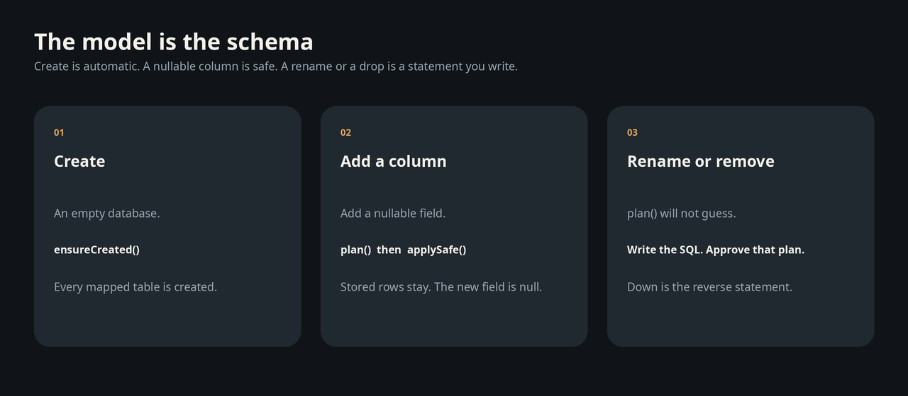

# sqlite_plus_orm

Dart objects on `sqlite_plus`. You change a field. `saveChanges` writes one transaction and bumps the revision. You change the class. The migrator creates the table, or asks you for the SQL when a change would drop data.

```yaml
dependencies:
  sqlite_plus_orm: ^0.1.2
```

## Save two books, rename one

The generator writes `BookMapping` from this class. `title` and `revision` are mutable, so the same object receives the stored revision.

```dart
import 'package:sqlite_plus_orm/sqlite_plus_orm.dart';

part 'models.orm.g.dart';

@DbEntity(table: 'books')
class Book {
  Book({this.id, required this.title, this.revision = 0});

  final BigInt? id;
  String title;
  @DbVersion()
  int revision;
}
```

```dart
import 'package:sqlite_plus_orm/sqlite_plus_orm.dart';

final connection = await MutableDatabaseConnection.openMemory();
final context = DbContext(connection, generatedModel);
await context.migrations.ensureCreated();

final books = context.set(BookMapping.instance);
final book = books.add(Book(title: 'Kept Garden'));
books.add(Book(title: 'Other Atlas'));
await context.saveChanges(); // 2

book.title = 'Kept Garden Revised';
await context.saveChanges(); // 1
await context.saveChanges(); // 0

final stored = await books.query
    .filter((row) => row.title.equalTo('Kept Garden Revised'))
    .single();
```

`stored.revision` is 1. An idle save writes nothing. The other book stays at revision 0.

## Create the table

`ensureCreated` is the first up. On an empty database it creates every mapped table.

```dart
await context.migrations.ensureCreated();
```



## Up: add a column

Add a nullable field and generate again.

```dart
@DbEntity(table: 'books')
class Book {
  Book({this.id, required this.title, this.subtitle, this.revision = 0});

  final BigInt? id;
  String title;
  String? subtitle;
  @DbVersion()
  int revision;
}
```

```dart
final plan = await context.migrations.plan();
await context.migrations.applySafe(plan);
```

Stored rows stay. `subtitle` is null. A second `plan()` is empty.

`applySafe` accepts a new table, a new nullable column, and a new non-unique index. A required column, a unique index, a type change, or a new foreign key is not applied this way.

## Up: rename the column

Renaming the Dart field and keeping `@DbColumn(name: 'title')` does not change the table. Changing the SQL name does. The migrator will not guess which old column matches the new one.

```dart
@DbEntity(table: 'books')
class Book {
  Book({this.id, required this.name, this.revision = 0});

  final BigInt? id;
  @DbColumn(name: 'name')
  String name;
  @DbVersion()
  int revision;
}
```

```dart
final reviewed = (await context.migrations.plan()).withOperations([
  MigrationOperation.sql(
    'ALTER TABLE books RENAME COLUMN title TO name',
    reason: 'Keep the stored titles',
  ),
]);
await context.migrations.apply(
  reviewed,
  approval: MigrationApproval.forPlan(reviewed),
);
```

`MigrationApproval.forPlan` binds that exact plan. A copied plan needs a new approval. If the statement fails, the transaction rolls back and the schema is unchanged.

## Down

Point the model at the previous column, then supply the reverse statement. Nothing is reversed for you.

```dart
final down = (await context.migrations.plan()).withOperations([
  MigrationOperation.sql(
    'ALTER TABLE books RENAME COLUMN name TO title',
    reason: 'Restore the previous column',
  ),
]);
await context.migrations.apply(
  down,
  approval: MigrationApproval.forPlan(down),
);
```

Removing a class is the same shape. `plan()` stops until you retain the table or drop it.

```dart
final dropped = (await context.migrations.plan()).withOperations([
  MigrationOperation.sql(
    'DROP TABLE books',
    reason: 'The model no longer maps this table',
  ),
]);
await context.migrations.apply(
  dropped,
  approval: MigrationApproval.forPlan(dropped),
);
```

`MigrationOperation.retainTable('books')` keeps the table and its rows, and stops managing it. A type change is a rebuild you write: create the new table, `INSERT SELECT` with your cast, drop the old table, and rename.

## Read it back

A JSON document is a path on the `@DbJson` field.

```dart
final notes = context.set(NoteMapping.instance);
final north = await notes.query
    .filter((row) => row.path(r'$.shelf').equalTo('north'))
    .toList();
```

A purchase points at its customer before the save. `load` returns the same instance the context already tracks.

```dart
final ada = customers.add(Customer(name: 'Ada'));
final order = purchases.add(Purchase(total: 12.5));
order.reference(PurchaseRelationships.customer).set(ada);
await context.saveChanges();
final buyer = await order.reference(PurchaseRelationships.customer).load();
```

With a generated mapping the filter is a closure:

```dart
final expensive = await purchases.query
    .filter((row) => row.total > 20.0)
    .orderByFields((row) => [row.total.ascending])
    .toList();
```

## The engine underneath

1,000 rows on Linux, release build. The same SQL, and every checksum matched. In memory, a transaction of inserts was 263× and search was 107×. On a file, search was 142× and a point lookup was 104×.


## Rules worth knowing

| Change | What happens |
|---|---|
| First schema | `ensureCreated` |
| Nullable column, new table, non-unique index | `plan` then `applySafe` |
| Unique index | `apply` with approval. Duplicates roll the save back |
| Rename, drop, type change, required column | You write the SQL, then approve that plan |
| Down | The reverse statement, after the model points at the old shape |
| Second `plan()` | Empty when the stored schema matches, including FTS5 and R-tree |

One object per key lives in the context. `saveChanges` freezes values before the first await and publishes generated keys after commit. A stale revision aborts the whole save. `count` returns `BigInt`.
