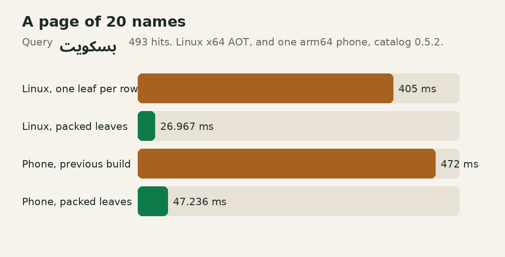
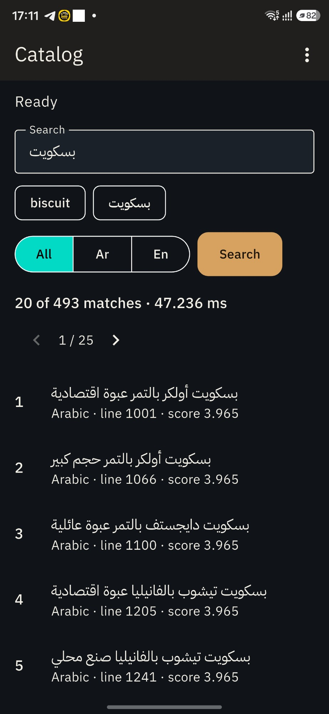

# sqlite_plus_search

Offline search for rows that already live in a [sqlite_plus](https://pub.dev/packages/sqlite_plus) database. The index sits in that same database. Keyword search is BM25 over packed FTS5 leaves. This package does not download a model and does not send text anywhere.

```yaml
dependencies:
  sqlite_plus: ^0.1.14
  sqlite_plus_search: ^0.1.0-dev.8
```

`0.1.0-dev.7` is a pre-release. The clinic shelf below is the example. The catalog measurement is at the end. Embeddings stay a local fixture you supply. The limits are in [doc/LIMITATIONS.md](doc/LIMITATIONS.md).

## Clinic shelf

`حَلِيب` is stored with a diacritic. The query is `حليب`. The pharmacy filter is your SQL, with the value bound. `شاي أخضر` stays out of that result. `mint tea` is inserted after `indexTable` and is found on the next search.

```dart
import 'dart:io';

import 'package:sqlite_plus/sqlite_plus_io.dart';
import 'package:sqlite_plus_search/sqlite_plus_search.dart';

final db = await openFileImage('clinic.db');
await db.execute(
  'CREATE TABLE notes(id INTEGER PRIMARY KEY, shelf TEXT NOT NULL, body TEXT)',
);
await db.execute(
  "INSERT INTO notes VALUES (1, 'pharmacy', 'حَلِيب للأطفال')",
);
final search = await SqlitePlusSearch.open(database: db);
await search.indexTable(
  table: 'notes',
  primaryKey: 'id',
  textColumns: ['body'],
  autoUpdate: true,
);
final pharmacy = await search.search(
  'حليب',
  table: 'notes',
  filter: SearchFilter('shelf = ?', ['pharmacy']),
);
print(pharmacy.hits.single.documentId); // 1
await File('clinic.db').writeAsBytes(db.exportImage(), flush: true);
```

`openFileImage` reads `clinic.db` in this process, or starts empty when the file is missing. `SqlitePlusSearch.open` uses that connection. `exportImage` writes the file back.


`SearchFilter` is trusted SQL. Put user text in the parameter list, not in the string. Do not add `WHERE`, `ORDER BY`, or `LIMIT`. The source table needs one non-null text or integer primary key. Indexed values are text or null. Names starting with `_sps_` are reserved for the derived index.

Keyword scores are larger-is-better. They are the engine BM25 value with the sign flipped. `limit` and `offset` apply after the filter. Order is stable only while the rows and the index stay still.

Run the whole walk, including the stem and the fixture:

```text
cd packages/sqlite_plus_search/example && dart run bin/main.dart
```

## Arabic stemming

The default analyzer folds diacritics and leaves words whole. `stemArabic: true` runs the light stemmer from [sqlite_plus_arabic](https://pub.dev/packages/sqlite_plus_arabic) on Arabic runs only, so `حديقة` finds `الحديقة`. Greek and CJK letters stay in the string. This is not the ICU Arabic tokenizer and not a morphological analyzer.

Use the same analyzer for indexing and for queries. If the signature changes, call `indexTable` again.

```dart
final search = await SqlitePlusSearch.open(
  database: db,
  analyzer: const SearchTextAnalyzer(stemArabic: true),
);
```

## Optional typo fallback

Fuzzy stays off until you ask for it. This shelf is its own file. `بسكوت` is one edit from `بسكويت`, and both words of `جودة بسكوت` have to match.

```dart
import 'dart:io';

import 'package:sqlite_plus/sqlite_plus_io.dart';
import 'package:sqlite_plus_search/sqlite_plus_search.dart';

final db = await openFileImage('typos.db');
await db.execute(
  'CREATE TABLE IF NOT EXISTS products(id INTEGER PRIMARY KEY, name TEXT)',
);
await db.execute(
  "INSERT INTO products(name) VALUES ('بسكويت جودة'), ('شاي')",
);
final search = await SqlitePlusSearch.open(database: db);
await search.indexTable(
  table: 'products',
  primaryKey: 'id',
  textColumns: ['name'],
);
final corrected = await search.search(
  'جودة بسكوت',
  table: 'products',
  fuzzy: const FuzzySearchConfig(maxEdits: 1, minTokenLength: 4),
);
final learned = await search.search(
  'جودة بسكوت',
  table: 'products',
  fuzzy: const FuzzySearchConfig(learnAfter: 5),
);
await File('typos.db').writeAsBytes(db.exportImage(), flush: true);
```

`corrected` returns the biscuit row. A row that only contains `جودة` stays out. `learned` records the typo. After the same successful query is repeated `learnAfter` times, the next search reuses the stored alternatives. `fuzzyCacheUsed` says that fast path was used. `recordFuzzyLearning: false` keeps a repeated page from counting as a new typo.

Fuzzy is off by default. In keyword or hybrid mode it runs only when keyword
search has no hits matching every query token after the source filter, before
pagination. With fuzzy enabled, exact matching joins literal lexical tokens with
AND; fallback joins alternatives within each token with OR and token groups with
AND. Thus `جودة بسكوت` can find `بسكويت جودة` without returning unrelated products
that only contain `جودة`. Existing all-token hits are never expanded. Alternatives
come from normalized derived text and use the existing FTS5/BM25 path. Hybrid embeds the
original query and fuses the resulting ranks as usual. Semantic-only mode rejects
this option.

Distance is Unicode-code-point Levenshtein: insertion, deletion, substitution;
transposition costs two edits. `maxEdits` is 1–2, `minTokenLength` is at least 1,
and `maxExpansions` is 1–64 alternatives per token. Alternatives sort by distance
then spelling before the cap; final document order uses BM25, not edit distance.
Candidate tokens are Unicode letter/number/mark/private-use runs. Custom analyzers
that implement special query syntax should leave fuzzy disabled unless tested
with this literal grouped AND/OR fallback.

This first implementation scans all derived text in pages of 512 rows and holds
its distinct vocabulary in memory on each fallback. It has no persistent fuzzy
index or large-corpus performance guarantee. Candidate caps apply before the
source filter and can exclude a useful filtered alternative. No schema change,
index rebuild or model download is needed for this option.

### Learn repeated typo alternatives

```dart
final result = await search.search(
  'جودة بسكوت',
  table: 'products',
  fuzzy: const FuzzySearchConfig(learnAfter: 5),
);
```

Learning is opt-in (`learnAfter: null` by default). A successful first-page fuzzy
fallback records one observation per normalized query token. Before the threshold,
only tokens/counters are stored; alternatives remain empty. The fifth successful
observation stores the candidate lists; the sixth query can reuse them without
scanning text, when every query token has a ready entry. Alternatives preserve
ambiguity rather than selecting an assumed single correct word. All-word matching,
filters and ranking still apply. Uncached token combinations still use the scan.

`SearchResults.fuzzyCacheUsed` reports the fast path; `fuzzyLearningChanged`
reports writes the caller may need to persist. Pass `recordFuzzyLearning: false`
for navigation/retries that should not count as new input. Nonzero offsets never
train. Failed/empty and exact queries do not train. The catalog example counts
new submissions only and saves its image after learning writes; its displayed
search timing excludes that subsequent save.

Entries are scoped by collection, analyzer, fuzzy settings and threshold. Explicit
rebuild and pending-change replay delete collection entries transactionally.
Without autoUpdate, source edits require the existing explicit rebuild contract.
Learning uses a separate ordinary metadata table, not a full deletion index. Image
export includes it; hosts must persist their database as usual. Observation rows
for rare queries still consume space; no global eviction cap is implemented.
`verifyIndex` fingerprints derived indexes, not learned observations; malformed
active learning records fail explicitly and rebuild clears them.

## Optional match precision ordering

```dart
final result = await search.search(
  'red apple',
  table: 'products',
  ranking: const SearchRankingPolicy(
    fieldWeights: {'name': 3, 'description': 1},
  ),
);
```

Keyword mode supports an opt-in policy. Default precedence:

1. An indexed field equals the whole normalized token sequence (`exact`).
2. The sequence occurs inside one field (`phrase`).
3. All tokens are adjacent in one field, in another order (`adjacent`).
4. All words occur, possibly scattered or across fields (`allWords`).
5. Learned/scanned fuzzy alternatives were needed (`corrected`).
6. A partial result from ordinary OR retrieval (`partial`).

Within a tier, weighted distinct-query-token coverage across indexed fields wins,
then the existing BM25/feedback score, then stable document id. Omitted fields
have weight 1; weights must be finite/nonnegative and name indexed text columns.
This is reranking, not native per-column BM25. `qualityOrder` can reorder all six
categories. `SearchHit.matchQuality` and `fieldScore` expose the classification;
`explain` adds numeric matchTier (0 is first) and fieldScore. `score` remains the
base relevance score and need not decrease across different precision tiers.

Normalization uses the configured analyzer and the engine's unicode61 tokenizer,
including its diacritic folds. Phrase matching never crosses a field boundary.
Punctuation/case/Arabic folding follow these rules, not raw byte equality.
All candidates are ordered before pagination; filters, hit counts, exact-first
fuzzy retrieval and learned alternatives are preserved. Exact-first retrieval
still suppresses fuzzy expansion, rather than combining both result populations.

No new persistent index is created. A single indexed text column reuses the
normalized derived text already fetched in the key-mapping probe. Multiple fields
share the existing source-key probe with extra projected text columns; there is
no query per hit or scan of nonmatching documents. CPU/memory cost grows with the
matching text and result count. The policy defaults off and currently rejects
semantic/hybrid mode; those modes retain their existing ranking without it.
Custom analyzers with special MATCH syntax need integration tests. The policy uses the engine's public `Unicode61Tokenizer`.

## A vector beside the words

`SearchMode.hybrid` mixes the keyword order with a vector order. You supply the vectors through `LocalEmbeddingProvider`. The provider must be local: no download and no network during `embed`.

`FixtureEmbeddingProvider` is a lookup table for tests and for this example. It returns a vector only when the string is one of its keys. `fresh milk` is a key, so the query works. `coffee` is not, so semantic search throws `StateError` instead of pretending the keyword result is a vector result.

```dart
final fixture = FixtureEmbeddingProvider(
  modelId: 'clinic-fixture-v1',
  dimensions: 2,
  vectors: {
    'fresh milk': [1, 0],
    'green tea': [0, 1],
    'milk powder': [0.8, 0.2],
  },
);
final search = await SqlitePlusSearch.open(
  database: db,
  embeddingProvider: fixture,
);
final hits = await search.search(
  'fresh milk',
  table: 'drinks',
  mode: SearchMode.hybrid,
  explain: true,
);
```

`explain: true` adds `keywordRank`, `vectorRank`, `baseScore`, `keywordWeight`, and `vectorWeight`. The fixture does not know that milk and tea are drinks. A real `LocalEmbeddingProvider` replaces that map with an already installed local model. Changing `modelId` or the dimension count requires `indexTable` again.

`embedding MATCH ? AND k = ?` is a different `sqlite_plus_vec` query. Search does not use it. Filtered ranking asks `rankVec0` for the eligible row ids, in pages of 512, so `k` is not applied before the filter. An unfiltered ranking scans the shadow in those same stopped pages.

## What stays in your hands

`open` creates metadata tables. It does not rebuild an index that is already in the file. Format 2 and older development indexes are rejected until you call `indexTable`.

`await search.verifyIndex(table: 'notes')` checks a SHA-256 of the derived rows, schema, metadata, and trigger text. A mismatch throws `StateError`. Rebuild with `indexTable`. A writer who can change both the index and the stored digest is not stopped by this check.

`await search.synchronize(table: 'notes')` applies the pending trigger log without running a query. Do not run other statements on the same database while a search call is in progress, and do not call search inside an application transaction.

`learning: const AdaptiveLearningConfig(enabled: true)` stores a small local weight for one table. Label one returned hit once:

```dart
await search.feedback.submit(
  searchId: results.searchId,
  documentId: '1',
  relevance: Relevance.high,
);
```

Two weights move keyword and vector ranks. They can make ranking worse. The example does not turn learning on. Held-out judgments belong to the application. Synthetic fixtures are not evidence of model quality.

See [architecture](doc/ARCHITECTURE.md), [status](doc/IMPLEMENTATION_PLAN.md), and [limitations](doc/LIMITATIONS.md). The catalog numbers above are keyword search on packed leaves. The synthetic embedding harness recorded a later append run: 10,000 documents indexed in 4.704192 s and one change synchronized in 1.699659 s. Those files are in the repository benchmark results. That harness is not a language model.

## Twenty thousand names

A page loads 20 names out of the full hit count. The time on the line is that search.

The catalog holds 10,000 Arabic product names and 10,000 English product names. On one arm64 phone, release build 0.5.2, `بسكويت` read `20 of 493 matches · 47.236 ms`. That was page 1 of 25. The keyword score on those titles was 3.965.





The same lists on Linux x64, Dart 3.13.7, AOT, and not a phone:

| Query | Page of 20 | Offset 320 | Raw `MATCH` |
|---|---:|---:|---:|
| `بسكويت` | 26.967 ms, then 20.819 ms | 25.663 ms | 18.861 ms |
| `biscuit` | 19.717 ms, then 25.481 ms | 25.621 ms | 20.249 ms |

Each of those queries returned 493 hits. Indexing took 46.880 s. The image was 3,387,392 bytes and held 347 leaves. Pinned SQLite 3.53.1 opened that image: `integrity_check` returned `ok`, and both queries returned 493 rows.

Before the leaves were packed, that Linux process took 405 ms and then 359 ms. The previous phone build showed 472.000 ms for page 17 of `بسكويت`. Those searches read one leaf per product.

A query of whole terms reads the leaves that contain those terms, plus one document-length blob. One document keeps the older leaf. An index that still has one leaf per product searches as before. Rebuild it to pack the leaves.

| Package | Version | Page |
|---|---|---|
| sqlite_plus | `^0.1.14` | <https://pub.dev/packages/sqlite_plus> |
| sqlite_plus_arabic | `^0.1.6` | <https://pub.dev/packages/sqlite_plus_arabic> |
| sqlite_plus_vec | `^0.1.6` | <https://pub.dev/packages/sqlite_plus_vec> |
