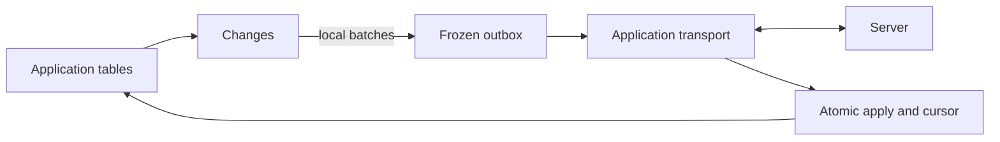

# sqlite_plus_sync

Optional, state-based synchronization for `sqlite_plus`, built on
`sqlite_plus_changes`. Work locally without a connection, freeze pending changes
into a durable outbox, then explicitly push and pull through your server adapter.

`0.0.1-dev.1` is a pre-release. Pure Dart. No background networking and no server in this package. The application supplies the transport and calls `runOnce`.

```yaml
dependencies:
  sqlite_plus: ^0.1.13
  sqlite_plus_changes: ^0.0.1-dev.1
  sqlite_plus_sync: ^0.0.1-dev.1
```

## Run the example

From the repository root:

```sh
dart pub get
dart run packages/sqlite_plus_sync/example/main.dart
dart run packages/sqlite_plus_sync/example/shared_assertions.dart
```

The [two-device example](example/main.dart) uses a
[development-only in-memory reference server](example/memory_server.dart). It
checks convergence and verifies that incoming writes remain visible to other
Changes consumers without being sent back to the server. The reference server
is neither durable nor authenticated and is not a production backend.

## Client setup

Create your ordinary application table and explicitly enable recursive triggers
on each writer connection. `transport` below is your `SyncTransport` adapter.

```dart
import 'dart:io';

import 'package:sqlite_plus/sqlite_plus_io.dart';
import 'package:sqlite_plus_changes/sqlite_plus_changes.dart';
import 'package:sqlite_plus_sync/sqlite_plus_sync.dart';

final db = await openFileImage('catalog.db');
await db.execute('PRAGMA recursive_triggers=ON');
await db.execute(
  'CREATE TABLE IF NOT EXISTS products(id TEXT PRIMARY KEY, name TEXT, price INTEGER)',
);

final changes = await SqlitePlusChanges.open(database: db);
final sync = await SqlitePlusSync.open(
  changes: changes,
  transport: transport,
  scope: 'tenant-42:catalog',
  // Optional on first creation; otherwise a random persisted ID is generated.
  replicaId: 'device-a',
);
await sync.register(table: 'products', columns: ['name', 'price']);

// Local writes do not require a network connection.
await changes.transaction((tx) async {
  await tx.execute('INSERT INTO products VALUES(?,?,?)',
      ['product-1', 'حليب', 10]);
});

// One bounded push, then one pull page; schedule calls in your application.
final result = await sync.runOnce();
await File('catalog.db').writeAsBytes(db.exportImage(), flush: true);
```

`result.pushed` is how many local mutations left this device. `result.pulled` is how many remote records landed in `catalog.db`. A lost reply retries the same operation id. A conflict stays stored until the application keeps the local row or accepts the remote row.

`scope` identifies one stable server dataset per local database. Reopening with a
different scope, replica identity or Changes generation fails explicitly. The
server must authorize the dataset; a client-provided scope is not authentication.

Register complete declared primary keys (inferred unless supplied). Keys retain
non-null signed64 integer/text types, including composite keys. Use consistent
schemas and binary key identity across replicas; case-folding/custom key
collations and arbitrary foreign-key dependency ordering are not resolved by the
protocol. Sync columns must be writable SQL columns. Generated/domain values may
remain outside the synchronized column set. No schema migration is automatic.

## Existing data and registration

`register` tracks future source writes through Changes. Existing rows require an
explicit `seedExisting: true`; otherwise registration rejects them:

```dart
await sync.register(
  table: 'products',
  columns: ['name', 'price'],
  seedExisting: true,
  maxSeedRows: 1000,
);
```

The seed is one frozen full-row operation expecting absent server keys. Existing
server rows may cause a conflict; the package does not silently replace them.
Drain an existing outbox before seeding another nonempty table. Repeating an
identical completed registration is idempotent; different keys/columns fail.

Changes tracking and Sync registration are separate recoverable commits. An
interrupted registration can leave Changes tracking installed; retry the same
registration after recovery. It does not silently untrack a source or migrate
partially existing metadata. Registration/open require exclusive connection use.

## How synchronization works



1. Read committed Changes and the current source rows. Coalesce affected keys
   into one operation, save its immutable payload and acknowledge consumption
   **in the same local transaction**. Intermediate edits are not a history feed.
2. Push that operation with a persisted replica/feed/sequence ID. A failed or
   lost reply leaves its ID and payload unchanged for retry. Only one operation
   is in flight; newer local edits remain in Changes for a later operation.
3. A complete accepted reply updates server revisions and removes the outbox
   atomically. It does not overwrite source rows, preserving edits made during
   the network wait. A rejected reply becomes a durable blocking conflict.
4. Pull one page after the stored opaque cursor. Detect unsent local changes
   inside the applying transaction. Apply eligible records, revisions, origin
   markers and the new cursor in one commit. Failure leaves that page unapplied.

Incoming writes are ordinary guarded Changes writes. Sync records an origin
marker with their event batch; only its own outbound consumer skips that batch.
Other consumers, including caches, still receive those events. No-op incoming
writes create no marker that could accidentally suppress the next local batch.
Source triggers/affinity must reproduce the supplied registered values. Changes
to additional synchronized keys must be listed by the remote page; unexpected
registered-key side effects reject and roll back the page.

`runOnce` is not one transaction spanning the network. A push can be accepted
before a later pull fails; retrying resumes durable local state. Transport errors
propagate. With conflicts, stop and resolve them; otherwise use `hasMore` to
request further pages. Your adapter owns networking, authentication, timeouts and
application retry/backoff scheduling.

## Transport and server contract

Implement these methods; HTTP and other transports need no engine internals:

```dart
abstract interface class SyncTransport {
  Future<SyncPushResult> push(SyncOperation operation);
  Future<SyncPullPage> pull(SyncPullRequest request);
}
```

| Requirement | Server/adapter responsibility |
|---|---|
| Idempotence | Durably deduplicate operation ID **and payload**, including rejected outcomes, for every possible retry. Never apply a retried operation twice. |
| Optimistic concurrency | Compare every mutation's `baseVersion`, then atomically apply the complete operation or reject all of it. |
| Revisions | Assign increasing positive signed64 revisions per key, including deletions/resurrection. Never forget a known tombstone and report it as an unknown key. |
| Push reply | Echo the operation ID and return exactly one current full registered snapshot per mutation. Rejection of a never-created key uses null values and revision zero; zero is invalid in accepted/pulled records. |
| Patches | New keys carry all registered fields; updates carry changed fields plus keys. Null `values` means deletion; a field set to SQL NULL is encoded inside a non-null values map. |
| Pull | Echo `request.after`, return a progressing opaque cursor, full registered row snapshots/tombstones, and `hasMore`. Respect record budgets; do not silently split atomic server work or omit records while advancing a cursor. |
| Ordering | Provide pages whose final record order satisfies the client's constraints. The client does not solve arbitrary dependency graphs. Local failure rolls back the page and cursor. |
| Values | Apply submitted patch values unchanged. Automatic server canonicalization requires an explicit application protocol; mismatched accepted values are rejected. |
| History expiry | Return an explicit error requiring application resnapshot; do not silently reset a cursor or reuse operation IDs. Automatic reset is not implemented. |

Protocol models provide `toJson`/`fromJson`. `SyncCodec` tags SQL values:
signed64 integers are decimal strings, BLOBs are base64, and finite reals, text
and NULL retain their types. Revisions are strings in JSON. This avoids loss of
integer precision on JavaScript targets. Keys and value maps are defensive copies.

A local SQL row is not a conflict-free replicated data type. Default revision
checks reject overlapping writes even when fields might be independently merged.
Custom merge policies, automatic field merges and peer-to-peer protocols are
future work.

## Conflicts

No local row is overwritten automatically when unsent edits conflict. A stored
conflict blocks further network work until explicitly resolved:

```dart
for (final conflict in await sync.conflicts()) {
  print('${conflict.direction}: ${conflict.remote}');
  // Choose according to application policy or explicit user input.
  await sync.resolveConflict(conflict.id, SyncResolution.keepLocal);
}
```

- `keepLocal`: for a rejected push, rebuild the affected current local rows as a
  new operation based on the supplied server versions, using a **new** operation
  ID. For a pull conflict, preserve dirty local rows, apply unaffected remote
  rows, and send full local rows on the next run. The server may reject again if
  it has advanced in the meantime.
- `acceptRemote`: apply the supplied remote snapshots and explicitly discard
  pending local edits to affected keys through the resolution checkpoint.
  Pending edits to unrelated keys remain eligible for sending. This is a
  deliberate potentially destructive application choice.

Resolution is one local transaction, including its outbox/cursor/marker changes.
No exactly-once external side-effect guarantee is implied. Malformed protocol
responses, source constraints, schema drift and expired checkpoints throw errors
instead of becoming silently accepted conflicts.

## Ownership, persistence and limits

- Use Changes writer scopes for local writes. Raw SQL/ORM transactions are not
  intercepted. Feed operations require exclusive use of the connection; ordinary
  source writes through Changes may proceed while transport is awaiting a reply.
  Sync calls on the same connection serialize, including across reopened handles.
- Sync owns six `_spsync_*` tables, five indexes and the `_spsync_outbound` Changes
  consumer. Do not edit/reset them externally. Other Changes consumers retain
  independent progress. Source tables and their columns remain application-owned.
- Image-backed apps must persist the exported image after all relevant commits;
  an in-memory outbox is not durable across process exit. File durability follows
  the supplied engine storage backend. Finish active Sync calls before closing DB.
- Prune the Changes log explicitly through its normal acknowledged-prefix API.
  Sync does not delete other consumers' work or automatically prune history.
  A lagging Sync consumer can hold retention; forced expiry fails closed and
  requires application recovery. No automatic byte/age quotas are installed.
- Per-key revisions/tombstones remain locally stored. Server tombstones and
  deduplication records need a matching retention/resnapshot policy. Physical
  database files may reuse pages instead of shrinking after outbox deletion.
- Defaults: 1,000 outgoing mutations, 100 local transactions/10,000 events,
  1,000 pulled records; explicit caps are 100,000 mutations/pulled records,
  1,000 transactions and 1,000,000 events. A local batch is never silently split
  or skipped to fit a budget. Counts do not bound unusually large payload bytes.
- Before incoming application, dirty scans must reach the committed Changes
  head within 1,000 transactions/1,000,000 events; otherwise drain outgoing work
  first. No partial dirty scan authorizes overwriting an unchecked local row.
- Raw backup copies preserve replica/feed identities. Fork/restore detection is
  not automatic. A changed Changes generation is rejected; explicit resnapshot
  into a correctly reidentified database is an application procedure in this
  milestone, not a metadata reset performed by the package.
- Per-key server metadata is loaded into a writer-scoped map once per local phase;
  updates refresh that map, and rollback discards its writer. Memory therefore
  grows with known keys, not only pending mutations. Conservative source scans,
  indexed metadata and anchors avoid known engine lookup/publication limitations.
  Large retained datasets need further memory/CPU profiling.

## Performance, validation and current status

Importing/linking Sync without opening it adds no Sync SQL, schema, capture hooks
or background work. Linking reachable optional code can increase executable size.
See [AOT cost, size and disabled comparison](benchmark/RESULTS.md) for measured
samples and reproduction; no universal zero-overhead claim is made.

Verified locally on Dart 3.13.7/Linux x64:

- 60 Sync tests, including 24 recovery scenarios and 380 injected storage faults.
- 38 Changes tests, including its 80 injected storage faults.
- 10,634 engine tests pass; one optional SQLCipher CLI test is skipped because
  its executable is absent. Search: 86; existing Flutter catalog: 17.
- Pinned official SQLite 3.53.1 SQL/image checks and VM/compiled Node assertions.

Faults model delete/persist rollback journals with volatile/immediate storage. The
[implementation plan](IMPLEMENTATION_PLAN.md) records completion and remaining
gates. Actual browser persistence, devices, WAL-specific Sync recovery, production
server adapters, large retained logs, remote CI and deployment are not verified.
